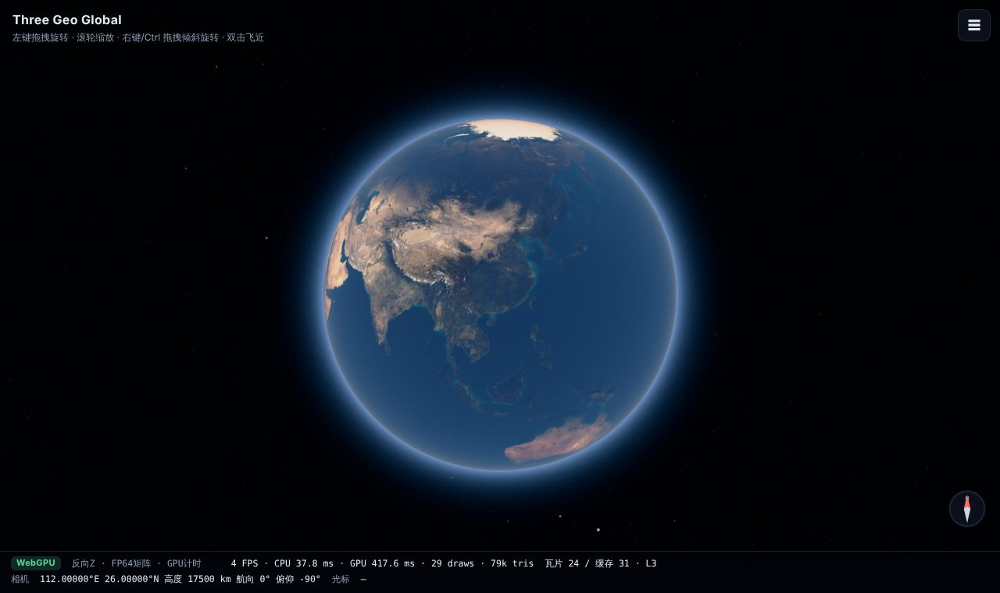
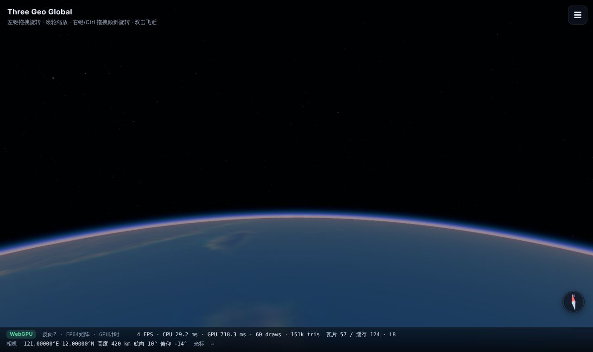
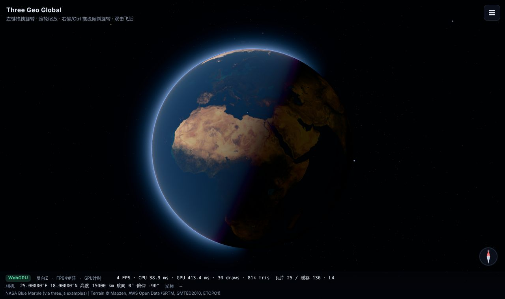
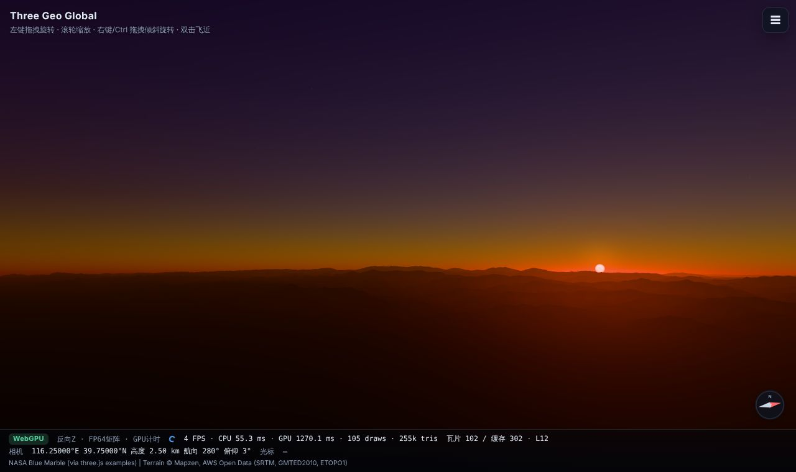
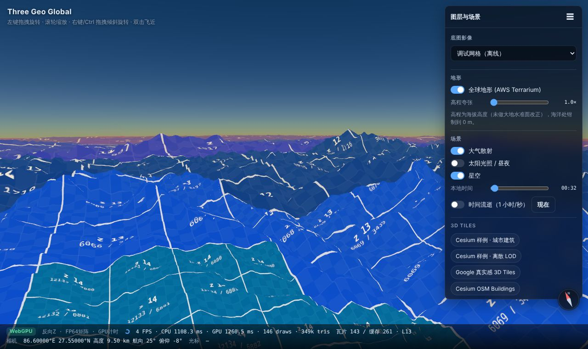
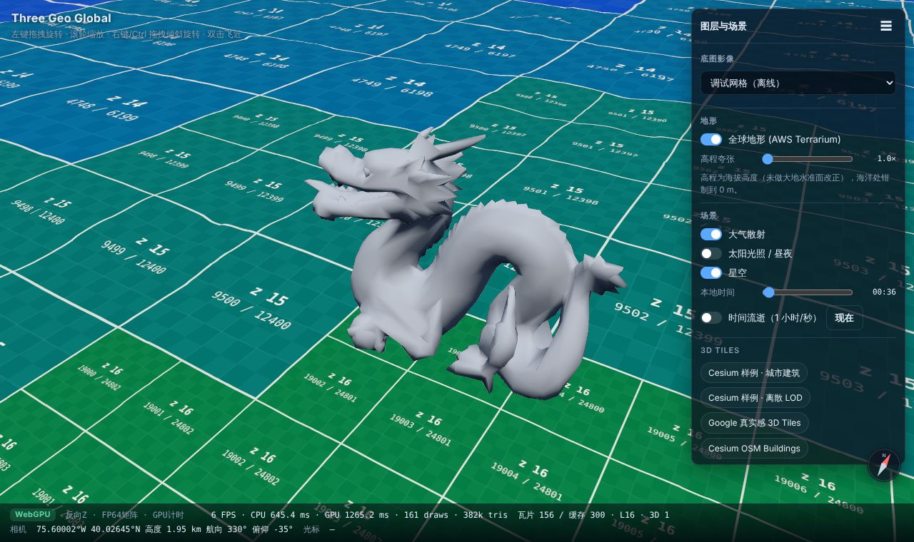
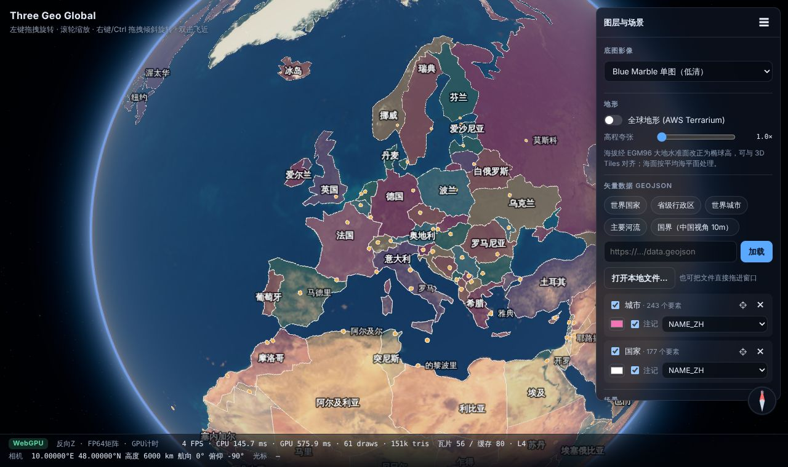
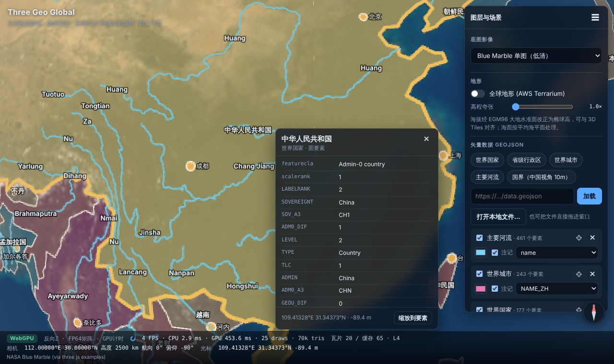
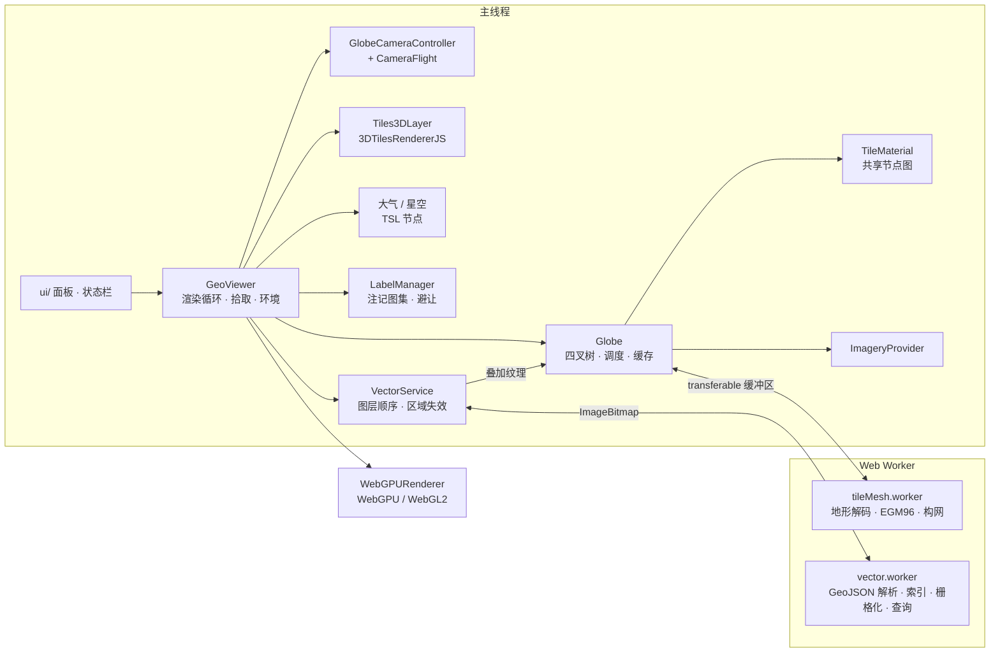

# Three Geo Global

基于 three.js 的 **WebGPU 优先** 三维地理空间浏览器：WGS84 椭球、四叉树影像瓦片、全球地形、物理大气、OGC 3D Tiles、GeoJSON 矢量与注记。
对标 CesiumJS / Google Earth 的核心浏览体验，先实现一个可扩展的基础版本。

| 全球视角（WebGPU） | 近地轨道大气 | 昼夜晨昏线 |
| --- | --- | --- |
|  |  |  |

| 北京西山日落（地形 + 大气） | 地形 + 四叉树 LOD（调试网格） | 3D Tiles 贴合地形 |
| --- | --- | --- |
|  |  |  |

| GeoJSON：国界分色 + 城市点 + 中文注记避让 | 点击要素：属性面板 + 高亮 |
| --- | --- |
|  |  |

> 截图在无头 Chromium（SwiftShader 软件 GPU）里生成，沙箱访问不了 ArcGIS/OSM，所以用的是 Blue Marble 单图和调试网格影像。本地运行默认是 ArcGIS 卫星影像。

## 快速开始

```bash
npm install
npm run dev        # http://localhost:5173
npm run build      # 类型检查 + 生产构建到 dist/
npm test           # 核心数学单元测试（vitest）
```

需要 Node 20.19+ / 22.12+。浏览器：Chrome / Edge 113+ 走 WebGPU，其他支持 WebGL 2 的浏览器会自动回退。

### URL 参数

| 参数 | 作用 |
| --- | --- |
| `?webgl` | 强制使用 WebGL 2 后端（对比调试用） |
| `?imagery=osm` | 指定底图：`esri-imagery` `osm` `carto-voyager` `carto-dark` `esri-topo` `tianditu-img` `blue-marble` `debug` |
| `?noterrain` | 启动时关闭地形（地形源在面板里切换，含 Mapbox / MapTiler / Cesium World Terrain / quantized-mesh） |
| `?tileset=<url>` | 启动后加载一个 3D Tiles（tileset.json） |
| `?geojson=<url>` | 启动后加载 GeoJSON（可重复多次） |
| `#lon,lat,height,heading,pitch` | 相机位置（会随浏览自动更新，可直接分享链接） |

### 操作

- 左键拖拽：抓住地面旋转地球（光标下的点始终跟手），松手有惯性
- 滚轮 / 双指捏合：向光标处缩放
- 右键、中键或 Ctrl/Shift + 左键拖拽：绕光标处的点旋转航向、调整俯仰
- 双击：飞近该点；指北针：点击复位朝北
- 单击矢量要素或注记：弹出属性面板并高亮；Esc 关闭
- 把 `.geojson` / `.json` 文件直接拖进窗口即可加载
- 键盘：WASD / 方向键平移，Q/E 转向，R/F 俯仰

## 已实现能力

**渲染（WebGPU 优先）**
- `WebGPURenderer`，WebGPU 不可用时自动回退 WebGL 2；所有着色器用 TSL 编写，同一份代码编译成 WGSL / GLSL
- 行星尺度精度：世界坐标即 ECEF（米），开启 `renderer.highPrecision`（模型视图矩阵在 CPU 上以 float64 计算）+ 每个瓦片自带原点（RTC），从太空到街道级都不抖动
- 反向 Z 浮点深度缓冲（WebGPU 原生；WebGL 走 `EXT_clip_control`），配合动态近/远裁剪面，无 Z-fighting
- GPU 计时（WebGPU timestamp query）显示在状态栏
- 所有地球瓦片共享同一套节点图 → 只编译 1 条 GPU 管线，逐瓦片纹理通过 `materialReference` 绑定

**地球与数据**
- WGS84 椭球数学（Newton 迭代投影、ENU 坐标系、射线求交），全部 float64
- Web Mercator 四叉树：屏幕空间误差（以“影像纹素占多少 CSS 像素”计）选择 LOD、视锥裁剪 + 椭球地平线裁剪（Cesium 的 horizon culling point）、裙边消除裂缝、极地补盖（颜色取自影像边缘）
- 加载调度：按层级 + 距离排序的优先队列、并发上限、离开视野自动取消请求、叶子优先的 LRU 淘汰、子瓦片未就绪时父瓦片兜底（无空洞）、超出影像最大层级时放大祖先纹理
- 影像源：XYZ 模板（ArcGIS、OSM、Carto、天地图等预设 + 自定义 URL）、单张等经纬度全球图、离线调试网格
- 叠加图层：天地图影像注记、Esri 边界地名 / 交通、Carto 注记、OpenRailwayMap 等半透明图层，可调不透明度、顺序、显隐；与矢量栅格一起**合成为每个瓦片的一张叠加纹理**，着色器始终只多一次纹理采样；压缩瓦片缓存，矢量变化时不重复下载
- 地形源（在 Web Worker 里解码并构网，含法线、包围体、地平线点，超出最大层级时从父级上采样；可调高程夸张）：
  - AWS Terrain Tiles（Terrarium，免 key）、Mapbox Terrain-RGB、MapTiler Terrain（RGB 编码）
  - Cesium World Terrain（ion）与任意 **quantized-mesh** 服务（layer.json）：按 EPSG:4326 地理瓦片取数，三角网栅格化后重采样到墨卡托网格，缺失瓦片自动回退父级
- 高程基准：海拔类数据经 **EGM96 大地水准面**（1° 网格，RMS 误差 0.41 m）改正为椭球高；quantized-mesh 本身是椭球高；两者都与 3D Tiles、GNSS 数据对齐

**大气与环境**
- 物理单次散射大气（Rayleigh + Mie + 臭氧），视线方向光线步进，太阳方向用 Chapman 函数解析近似，替代嵌套循环
- 天空作为 `scene.backgroundNode` 逐像素计算；地面空气透视逐顶点计算（便宜且平滑）
- 两种模式：地图模式（影像原色 + 均匀光晕）与真实光照模式（按日期时间计算太阳位置、昼夜、晨昏、日落色彩、太阳圆盘）
- 随恒星时旋转的星空

**3D Tiles**
- 基于 NASA-AMMOS 3DTilesRendererJS 的核心调度（b3dm / i3dm / pnts / cmpt / glTF、隐式分块）
- Draco / KTX2 / Meshopt 解码；Cesium ion、Google 真实感 3D Tiles 鉴权；GPU 显存回收
- 图层管理：显隐、飞到图层、高度偏移、一键贴地（针对以椭球面为基准的样例数据）

**GeoJSON 矢量与注记**
- 支持 Point / MultiPoint / LineString / MultiLineString / Polygon / MultiPolygon / GeometryCollection，来源可以是 URL、本地文件（拖拽）或对象
- 解析、投影、跨日界线展开、网格空间索引都在 **Web Worker** 里完成，大文件不卡主线程
- 线、面、点符号按地球瓦片实时栅格化成透明叠加纹理，**贴合地形**、无 Z-fighting；只重绘受影响区域的瓦片（按区域失效），加载期间用父瓦片叠加图放大兜底
- 样式：图层级填充 / 描边 / 点样式，按属性分类着色（如 Natural Earth `MAPCOLOR7`），兼容 simplestyle-spec 逐要素样式
- 注记：自动识别名称字段（优先中文 `name_zh` / `NAME_ZH`），面用“极点不可达点”（polylabel）、线用中点定位；按 `LABELRANK` / `scalerank` 排优先级，按 `min_label` / `min_zoom` 分级显示，屏幕空间碰撞避让 + 淡入淡出
- 注记位置用 GPU 端双精度模拟（RTE，高低位拆分），近距离也不抖；可见性由 CPU 判定（地平线 + 低空时沿视线采样地形遮挡）
- 点击查询：注记命中优先，其次在 Worker 里做点在面内 / 点到线距离判定，返回属性并高亮该要素
- 预设数据：Natural Earth 国界、省级区划、城市、河流（公有领域，示例用）

**交互与界面**
- 自研相机控制器（抓取式旋转、光标缩放、绕点环绕、惯性、触屏手势、键盘漫游、防入地）
- 大圆弧线飞行（高度随距离抬升，飞行中自动俯视）
- 图层面板、状态栏（帧率 / GPU 耗时 / 瓦片统计 / 相机与光标经纬高）、指北针、数据署名

## 架构



```
src/
├─ core/        椭球、测地学、EGM96、太阳位置、事件
├─ globe/       四叉树（Globe / GlobeTile）、分块方案、Worker、影像源、地形源、瓦片材质
├─ atmosphere/  散射节点（天空 / 空气透视）、星空
├─ tiles3d/     3D Tiles 图层封装
├─ vector/      GeoJSON 图层、矢量 Worker、注记管理、几何算法
├─ viewer/      GeoViewer、相机控制器、相机数学、飞行动画
└─ ui/          控制面板、状态栏、预设
```

最小代码示例：

```ts
import { GeoViewer } from './src/viewer/GeoViewer';
import { IMAGERY_PRESETS } from './src/globe/imagery/presets';
import { AWS_TERRARIUM } from './src/globe/terrain/TerrainSource';

const viewer = await GeoViewer.create({
  container: document.getElementById('viewer')!,
  imagery: IMAGERY_PRESETS[0].create(),
  terrain: AWS_TERRARIUM,
});
viewer.lighting = true;
await viewer.flyTo({ longitude: 116.397, latitude: 39.916, height: 3000, heading: 0, pitch: -40 });
viewer.addTileset({ source: { type: 'url', url: 'https://example.com/tileset.json' } });

const countries = viewer.addGeoJson({
  url: 'https://raw.githubusercontent.com/nvkelso/natural-earth-vector/master/geojson/ne_110m_admin_0_countries.geojson',
  style: { colorBy: 'MAPCOLOR7', fillOpacity: 0.2, stroke: '#ffffff' },
  label: { field: 'NAME_ZH' },
});
countries.events.on('ready', (s) => viewer.flyToBBox(s.bbox!));
```

## 与成熟产品对标

| 能力 | CesiumJS | Google Earth Web | Mapbox GL JS（globe） | ArcGIS JS SceneView | **本项目 v0.1** |
| --- | --- | --- | --- | --- | --- |
| 渲染后端 | WebGL 2 | WebGL / Wasm | WebGL 2 | WebGL 2 | **WebGPU 优先**，WebGL 2 回退 |
| 着色语言 | GLSL | 内部 | GLSL | GLSL | **TSL → WGSL / GLSL** |
| 椭球 + 高精度 | ✅ RTC / RTE | ✅ | 近似球 | ✅ | ✅ FP64 矩阵 + RTC |
| 影像瓦片 | ✅ 多图层叠加 | 内置 | ✅ 矢量瓦片为主 | ✅ | ✅ 底图 + 叠加图层 |
| 地形 | ✅ quantized-mesh | ✅ | ✅ raster-dem | ✅ | ✅ Terrarium / Terrain-RGB / quantized-mesh + EGM96 |
| 3D Tiles | ✅ 原生 | 自有格式 | 自有 3D 格式 | ✅ I3S / 3D Tiles | ✅ 3DTilesRendererJS |
| 大气 | ✅ | ✅ | 风格化 | ✅ | ✅ 物理散射 + 光晕 |
| 昼夜 / 太阳 | ✅ | ✅ | 风格化光照 | ✅ | ✅ 按日期计算太阳位置 |
| 矢量 / 标注 | ✅ | ✅ | ✅ 强项 | ✅ | ✅ GeoJSON 贴地 + 注记避让 |
| 阴影 / 后处理 | ✅ | ✅ | 部分 | ✅ | ⏳ 路线图 |

定位：在 three.js 生态里做一个“像 Cesium 一样懂地理、像 three.js 一样好扩展”的地球底座，并且从第一天起按 WebGPU 的方式写（TSL、计算着色器友好、绑定组 / 管线复用）。

## 已知限制

- 影像（底图与叠加）只支持 Web Mercator 瓦片，±85.05° 以外用纯色极盖
- Cesium ion / quantized-mesh、Mapbox、MapTiler 在开发沙箱里无法联网，只验证了解码与重采样（单元测试）和错误提示，需在真实网络下确认；ion 访问令牌约 1 小时过期，过期后需重新点“应用”
- LOD 严格自顶向下细化，长距离飞行后需逐级加载（尚未做 skip-LOD）
- 地形法线在瓦片边界用单侧差分，开启光照时可能看到细微接缝
- 3D Tiles 的渐显（TilesFadePlugin）与影像叠加（ImageOverlayPlugin）依赖 `onBeforeCompile`，在 WebGPU 下不可用，暂未启用；点云（pnts）在 WebGPU 下为 1 像素点
- 相机防入地只参考地形，不参考 3D Tiles 表面；隐藏地球（如加载 Google 3D Tiles）时以椭球面为准
- 矢量按瓦片栅格化贴地：线宽是屏幕像素级的，但瓦片切换的过渡期内线条会短暂变虚；暂不支持面拉伸（3D 建筑）、沿线排布的注记和图标符号
- 注记不会被 3D Tiles 建筑遮挡（只判断地平线和地形遮挡）
- 示例国界为 Natural Earth 的“事实边界”，**不是审定地图**；在国内发布须使用审图号地图数据（如天地图边界）
- 默认底图 / 地形服务仅用于开发演示，生产环境请使用自有服务或取得相应授权（OSM 瓦片使用政策、Esri 条款、天地图 key 等）

## 路线图

**近期（v0.2）——数据与可用性**
- 地形与 3D Tiles 统一高程查询（贴地、防入地都考虑 3D Tiles 表面）；瓦片边界法线拼接
- 矢量进阶：MVT 矢量瓦片、面拉伸（建筑白模）、沿线注记、图标符号、点聚合
- 3D Tiles 要素拾取与属性查询（EXT_mesh_features / batch table），高亮
- 跳级加载（skip-LOD）与基于帧预算的 GPU 上传

**中期（v0.3）——深度用好 WebGPU**
- 计算着色器预计算大气 LUT（透射率 / 多次散射 / 天空视图，Hillaire 2020），提升质量并降低每像素开销
- GPU 驱动的瓦片剔除与间接绘制（indirect draw），HZB 遮挡剔除
- 计算着色器驱动的大规模动态图层（轨迹、粒子、热力）
- 后处理：TAA / SMAA、Bloom、SSAO，太阳级联阴影投射到 3D Tiles

**产品化**
- 测量工具（距离 / 面积 / 高度）、视点漫游录制与回放、截图分享
- glTF / KML 模型摆放、裁剪面与压平（3D Tiles）、时态数据
- 国内数据适配：GCJ-02 纠偏（高德 / 腾讯影像）、天地图注记、CGCS2000

## 开发说明

- `scripts/generate-egm96.mjs`：从 NGA EGM96（经 `egm96-universal` 包）重新生成 `src/core/egm96Grid.ts`
- 依赖版本锁定为发布满两周以上的版本（three r186.1、3d-tiles-renderer 0.5.3、Vite 8）
- `.npmrc` 设置了 `legacy-peer-deps=true`：npm 在 Vite 8 + Vitest 5 的可选 peer 依赖环上有解析 bug

## 数据与致谢

three.js · NASA-AMMOS 3DTilesRendererJS · Mapzen / AWS Terrain Tiles · NGA EGM96 · Esri / OpenStreetMap / CARTO / 天地图（底图）· CesiumGS 3d-tiles-samples（示例数据）· Bruneton & Neyret、Hillaire、Schüler（大气散射方法）
