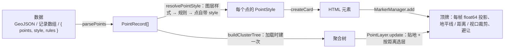

# 顶牌与点位标注（Marker / PointLayer）

代码：`src/markers/MarkerManager.ts`（HTML 顶牌：投影、裁剪、避让）、`src/markers/cards.ts`（样式模板）、`src/markers/points.ts`（点位数据解析、样式规则，纯函数）、`src/markers/clusterTree.ts`（层级聚合树，纯函数；大数据量在 `clusterTree.worker.ts` 里构建）、`src/markers/PointLayer.ts`（点位图层）、`src/markers/demoPoints.ts`（示例数据）、`src/core/CollisionGrid.ts`（屏幕网格碰撞索引，顶牌与矢量注记共用）。UI：`src/ui/PointPanel.ts`（"点位标注"面板）、`src/ui/FeaturePopup.ts`（点击弹出属性）。样式：`src/style.css` 的 `.tg-*`。测试：`tests/points.test.ts`、`tests/clusterTree.test.ts`。

## 1. 分层



- `MarkerManager` 只负责"把一个 DOM 元素钉在世界坐标上"，不认识数据。BIM 顶牌（`IndoorManager`）和点位图层都通过它显示。
- `PointLayer` 负责数据到顶牌的映射、贴地和聚合；解析和规则在 `points.ts`，聚合算法在 `clusterTree.ts`，都没有 three 和 DOM 依赖，可以单测。

## 2. 样式（`cards.ts` + `style.css`）

所有样式的锚点都是元素底部中点（pivot `[0.5, 1]`），调用方不用按样式改 pivot。以符号中心为锚点的样式，用负的下外边距让元素在符号中心处结束，符号的下半部分溢出元素。

| 样式 | 外观 | 锚点 | 适用 |
| --- | --- | --- | --- |
| `card` | 气泡卡片 + 引线 | 引线末端的圆点 | 建筑、告警详情 |
| `pin` | 胶囊文字 + 小圆点 | 圆点底部 | 设备 |
| `tag` | 紧凑标签 | 标签底部 | 房间 |
| `poi` | 水滴图钉（SVG），图标在圆内，文字在上方 | 针尖 | 地标、兴趣点 |
| `pulse` | 呼吸点 + 两圈扩散波纹（CSS 动画） | 圆点中心 | 告警、实时点位 |
| `beacon` | 光柱 + 地面光环，文字在柱顶 | 光环中心 | 远距离也要醒目的点 |
| `badge` | 实心圆徽章（图标或数字） | 圆心 | 分类站点、设备 |
| `label` | 带描边光晕的纯文字 + 小圆点 | 圆点中心 | 密集注记 |
| 聚合 `tg-cluster` | 数量圆盘，按数量放大（`createClusterCard`） | 圆心 | 聚合点 |

- `title` 为空字符串时只画符号（`poi` / `pulse` / `beacon` / `badge`），适合大批量点位。
- `--accent` 由 `color` 设置；`selected` 类表示选中（白色光晕）；可交互顶牌悬停时放大 8%。
- `pulse` 的动画在 `prefers-reduced-motion` 下关闭。
- 状态徽章（"告警"）的类名是 `.tg-status`（原 `.tg-badge`，已让给 `badge` 样式）。
- 新增样式：在 `MarkerStyleName`（`points.ts`）加名字，在 `createCard` 加分支，在 `style.css` 写 `.tg-<style>`，保持"元素底部中点 = 锚点"，并同步本表与 `PointPanel` 的中文名。

## 3. 数据格式（`parsePoints`）

| 输入 | 说明 |
| --- | --- |
| GeoJSON | FeatureCollection / Feature / geometry。`Point`、`MultiPoint`（逐点拆分，id 加 `-i`）、`GeometryCollection` 里的点；坐标 `[经度, 纬度, 高度?]`（度、米、WGS84 椭球高）。其他几何跳过并计数 |
| 记录数组 | `lon` / `lng` / `longitude` / `经度` 与 `lat` / `latitude` / `纬度`，可选 `height` / `alt` / `altitude` / `elevation` / `高度`，或 `coordinates: [lon, lat, h?]`；其余字段作为属性 |
| 点位文档 | `{ "points": [...], "style": {...}, "rules": [...] }`：记录同上；`style`、`rules` 作为图层默认值（调用方传入的优先） |

- 没有高度的点贴地：先用粗略地形高度，拿到网格间距 ≤ 150 m 的地形后改用精确高度（与建筑贴地一致），之后按轮询继续跟随地形细化，每帧最多重算 256 个点。
- id 缺省为 `p<序号>`，重复时自动加后缀，保证唯一。
- 无效坐标（超出经纬度范围、非数字）跳过，`warnings` 给出前 8 条问题及其位置（如 `features[3]`）。

## 4. 样式规则

```ts
viewer.addPoints({
  url: '/data/stations.json',
  style: { style: 'badge', title: '{name}', icon: '{icon}', maxDistance: 80_000 },
  rules: [
    { when: { type: '视频' }, style: { color: '#a78bfa' } },
    { when: { status: '离线' }, style: { color: '#8a94a6', subtitle: '离线' } },
    { when: { status: '告警', value: { gt: 80 } }, style: { style: 'pulse', color: '#ff5d5d', badge: '告警', priority: 10, declutter: false } },
  ],
  cluster: { radius: 56, minPoints: 3 },
});
```

- 合并顺序：图层 `style` → 依次应用所有命中的规则（后面的覆盖前面的）→ 点自身的 `style` 属性（对象）。
- 条件：值相等（数字与数字字符串互相匹配）、数组表示"属于其中之一"、`{ eq, ne, gt, gte, lt, lte, in }` 比较；`null` 匹配空值和缺失的属性。一条规则里的多个条件同时成立才算命中。
- 文本字段（`title`、`subtitle`、`icon`、`badge`）是模板，`{字段}` 替换为属性值；不写 `title` 时，依次取 `name`、`title`、`label`、`名称`、`id`。
- 其他字段：`heightOffset`（米）、`minDistance` / `maxDistance`（相机距离，米）、`scaleByDistance: [近, 远, 最小缩放]`、`declutter`（默认 true）、`priority`、`zIndex`。

## 5. 聚合与性能

### 5.1 聚合树（借鉴 Mapbox Supercluster）

- 只在数据、样式或聚合半径变化时，由 `buildClusterTree` 建一次层级。
  - 从 `maxZoom`（默认 18，约 0.6 m/px）逐级建到 0 级。
  - 每一级把上一级的节点按优先级从高到低处理：落在已有种子 `radius × 该级米/像素` 范围内就并入，否则自己成为新种子。
  - 只有一个成员的组原样带到上一级，不生成单子节点。
- 与 Supercluster 的差别（针对三维地球）：
  - 距离用 ECEF 弦长（米），不用 Web 墨卡托，所以高纬度地区和跨 180° 经线都正确。
  - 每帧按每个节点到相机的距离分别选层，屏幕层级 = `log2(156543 / (距离 × 2tan(fov/2) / 视口高))`。倾斜视角下近处拆开、远处保持聚合，类似瓦片的屏幕空间误差。
  - 聚合点画在种子位置（簇内优先级最高的点），不画在质心，所以始终落在真实点和地形上。
- 每帧由 `ClusterSelector.select` 只遍历可见分支：
  - 用包围球做视锥剔除（视锥按 NDC 1.2 放宽，与顶牌裁剪一致），并按距离范围剔除。
  - 耗时与画出的标记数成正比，与总点数无关（3000 点约 0.06 ms）。
  - 层级边界有 0.15 级滞回，避免来回切换。
- 簇是世界空间里固定的分组，平移时不重排。聚合顶牌按树节点缓存，离开视野后回到池里复用。
- 成员不少于 `minPoints`（默认 3）的簇显示为聚合点，更小的簇直接显示其中的点。
- 聚合点不参与避让（作为障碍物）；单击时飞到簇内点的范围。
- 点的 `minDistance` / `maxDistance` 汇总到节点上（取并集）；整簇都超出范围时整簇不画。
- 建树耗时：约 3 千点 20 ms、10 万点 0.2 s。
  - 点数 ≥ 1 万时在 Worker 里建（`clusterTree.worker.ts`，不引入 three）。
  - 建好之前该图层不画。
- 已知取舍：选中的点如果在某个聚合里，不会单独弹出。

### 5.2 顶牌（`MarkerManager`）

| 手段 | 借鉴 | 说明 |
| --- | --- | --- |
| 网格碰撞索引 | Mapbox GL `GridIndex` | `CollisionGrid`（64 px 网格），避让 O(n)。原实现逐个和已放置的矩形比较，3000 个点每帧约 450 万次 |
| 定时放置 | Mapbox GL 符号放置 | 避让每 150 ms 重算一次。中间帧沿用上次的显隐结果，只更新位置；新进入视野的顶牌最多等 50 ms。每帧重算会让缩放时大量顶牌闪烁，并反复切换 `display` |
| 只写变化值 | — | transform 取整到 0.1 px，与上一帧相同就不写；z-index、display 同理。相机静止时没有样式开销 |
| z-index 不随距离变 | — | 参与避让的顶牌互不重叠，只按 `zIndex` 分层；只有障碍物（不参与避让的）按距离排序 |
| 批量测量 | — | 新元素在一次布局里测完（`measureAll`） |
| 密集模式 | — | 显示数超过 80 时给图层加 `dense` 类（低于 60 时去掉），去掉 `backdrop-filter` 和 `drop-shadow`。`backdrop-filter` 每帧都要把下方的 WebGPU 画面重新模糊一次，几百个就会拖垮合成；点位样式默认不用它 |
| 按需创建 DOM | 虚拟列表 | 点位第一次需要显示时才创建元素，每帧最多 200 个，其余在后续几帧补齐；被聚合或不在视野内的点没有 DOM |

### 5.3 实测与规模

3000 个随机点、60 km 俯视、相机持续缩放，单帧 CPU 耗时（图层 + 顶牌 + 样式布局）：

| 场景 | 优化前 | 优化后 |
| --- | --- | --- |
| 开聚合 | 约 11 ms（最差 25 ms），DOM 3135 个 | 约 1.3 ms，DOM 73 个 |
| 不聚合（全部在视野内，靠避让） | 约 13 ms（最差 114 ms） | 约 5.7 ms；首帧建 DOM 的尖峰分摊到多帧 |

- 统计：
  - `viewer.markers.stats`：显示数、候选数、被避让数、耗时。
  - `layer.stats`：本帧画出的点数和聚合数、已建 DOM 数、树节点数、建树耗时。
  - 状态栏显示"顶牌 显示数 / 总数 (ms)"。
- DOM 顶牌的上限取决于同时显示的数量，而不是总点数：开聚合时 10 万点也只画几十到几百个。
- 不聚合且同时显示上千个、需要深度遮挡或每秒刷新的数值，应走 GPU 方案（路线图 M3.6 合批、M4.6 高频数值标签，类似 Cesium `BillboardCollection`、deck.gl `IconLayer`）。

## 6. 交互与 API

```ts
const layer = viewer.addPoints({ data, style, rules, cluster: true });
layer.events.on('ready', ({ count, skipped, bbox }) => viewer.flyToBBox(bbox!));
layer.events.on('click', ({ point }) => console.log(point.id, point.properties));
layer.setStyle({ ...layer.style, style: 'pulse' });   // 规则仍然生效
layer.setCluster(false);
layer.select('st003');                                 // 高亮，避让中优先
layer.visible = false;
viewer.removePoints(layer);
```

- 单击点位：选中并弹出属性（`viewer.events` 的 `point-click`，`FeaturePopup` 订阅）；双击飞近。点在画布别处会关闭弹窗并取消选中。
- 顶牌盖在 canvas 上，自己处理单击、双击；滚轮由 `MarkerManager` 转发给 canvas（AGENTS.md §3.7）。
- 加载入口：面板"点位标注"（示例数据、URL、本地文件）；URL 参数 `?points=<url>`（可重复）；把 `*.points.json` 拖进窗口。

## 7. 验收

- `npm test` 覆盖解析（GeoJSON、记录数组、文档默认值、错误位置）、规则（比较、顺序、模板）、聚合树（全覆盖、确定性、包围半径、种子优先级、跨 180° 经线、距离范围、视锥剔除、滞回、minPoints）和碰撞网格。
- 手测：加载三组示例数据；告警站点呼吸闪烁且不被避让隐藏；随机网点缩放时聚合数变化、平移时聚合不重排、倾斜视角下近处拆开远处聚合、点击聚合点会放大；切换样式后规则仍然生效；有地形时点位贴地，不悬空也不埋进地下。
