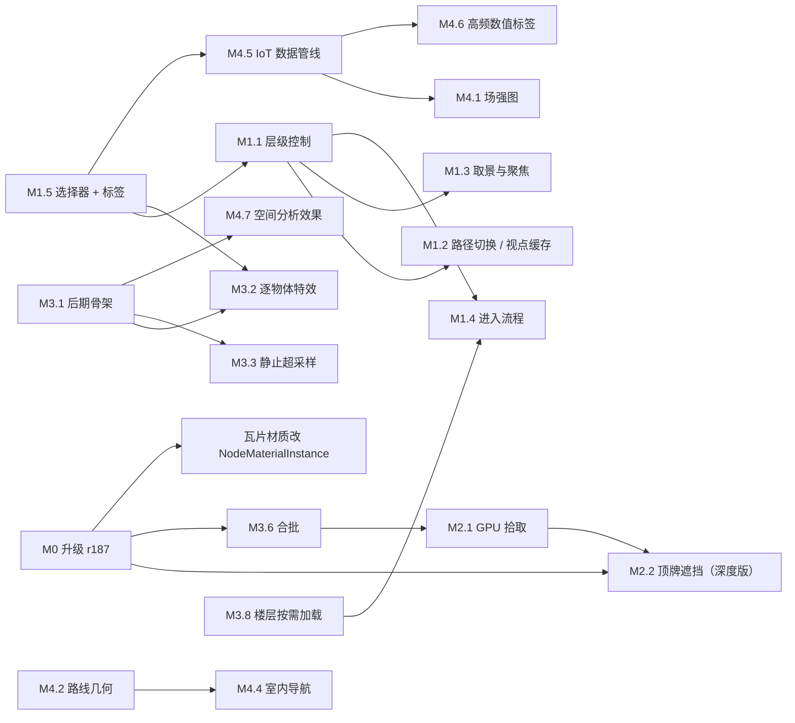

# 可借鉴与复用路线图

> 版本：2026-11-04，2026-11-05 按 three.js r187 复核（见 §8）。本文是后续开发的总路线：把外部来源中可借鉴、可复用的内容，对照本仓库现状和 three.js 的内置能力，整理成分阶段的落地计划。外部代码只做了静态阅读和检索，没有安装或执行。
>
> 文中"参考平台"指一款商业数字孪生平台的浏览器运行时（闭源，只公开构建产物）；"t3d 生态"指开源的 t3d.js 渲染库及其配套扩展仓库。两类来源可以互相印证：参考平台里观察到的不少机制（拾取缓冲、静止超采样、后期缓冲依赖、遮挡查询、锚点矩阵），在 t3d 生态里都有公开实现。

## 0. 结论速览

1. **渲染底层不换，复用分三层**：
   - **直接用 three r186 内置**：描边、TRAA / SSAA、GTAO / SSR、OIT、成簇光照、级联阴影、高斯泼溅、遮挡查询、异步像素回读、`BatchedMesh`、宽线。这些在 t3d 里是自研扩展，three 已经现成，不再移植。
   - **移植算法（BSD-3 / MIT，保留版权声明）**：three 没有、或不适合我们场景的部分。包括拾取缓冲布局、静止超采样、遮挡代理管理、贡献剔除、八面体冒名顶替、IDW / 热力场生成、路线与带洞挤出构建器、阴影范围适配、动态字形图集。CPU 部分大多是纯函数，可以直接放进 Worker。
   - **只借鉴设计**：参考平台的层级控制、选择器、事件选项、取景策略、样式池、可见性驱动加载、IoT 数据管线。对方只有构建产物公开，按思路自研。
2. 按依赖关系排成 6 个里程碑：M0 升级 three r187（前置）→ M1 室内层级与交互框架 → M2 拾取、遮挡与顶牌 → M3 画质与性能 → M4 孪生数据与空间分析 → M5 工程与工具（持续）。
3. 最先做的 3 件事：**层级控制策略化（M1.1）**、**选择器表达式（M1.5）**、**GPU 拾取缓冲（M2.1）**。后两者是后面大多数功能的前置条件。M0 不阻塞 M1，但必须在 M2.2、M3.6 之前完成。
4. **2026-11-05 复核结论**（§8）：
   - 与 three 官方的进展没有方向冲突。
   - 有 4 处需要修正：
     - r186 的 `BatchedMesh` 在 WebGPU 上每个实例单独一次 draw，到 r187 才开始合并。
     - r186 的遮挡查询在多相机下会串结果，r187 修复。
     - r187 新增 `NodeMaterialInstance`，正是我们瓦片材质的写法，可直接替换。
     - 静止超采样、楼层 AO、阴影和帧快照，three 已有更完整的内置或 addon 方案，应先评估再决定是否自研。
   - 已完成：地球瓦片调度借鉴 CesiumJS 的改造（选择记忆、不丢细节守卫、象限填充、兄弟预建、雾化 SSE、取消即释放），见 [tile-loading.md](tile-loading.md)；点位标注（样式、规则、聚合），见 [markers.md](markers.md)。

## 1. 来源与许可

| 来源 | 版本 / 提交 | 许可 | 用法 |
| --- | --- | --- | --- |
| 参考平台 | 2026-11 在线版本；另有旧版构建产物和类型声明以 BSD-3 公开 | 构建产物 | 只借鉴设计，不搬运代码 |
| [t3d.js](https://github.com/uinosoft/t3d.js) | 0.5.5，`1f2c3c8`（2026-09-22） | BSD-3-Clause | 移植算法 |
| [t3d-effect-composer](https://github.com/uinosoft/t3d-effect-composer) | 0.4.2，`2a255f0` | BSD-3-Clause | 借鉴架构，移植个别效果 |
| [t3d-atmosphere](https://github.com/uinosoft/t3d-atmosphere) | 0.0.1，`c85ce60`（标注为开发中） | BSD-3-Clause | 借鉴"光照跟随大气"的思路 |
| [t3d-particle](https://github.com/uinosoft/t3d-particle) | 0.2.0，`f5e385f` | BSD-3-Clause | 借鉴数据驱动的配置格式 |
| [t3d-pano](https://github.com/uinosoft/t3d-pano) | 0.2.0，`b67cf9b` | BSD-3-Clause | 借鉴全景图的组织方式 |
| [t3d-3dtiles](https://github.com/uinosoft/t3d-3dtiles) | 0.4.0，`fa97309` | BSD-3-Clause（核心移植自 3DTilesRendererJS，Apache-2.0） | 不用：我们直接用上游 |
| [t3d-dynamic-sky](https://github.com/uinosoft/t3d-dynamic-sky)、[t3d-gaussian-splatting](https://github.com/uinosoft/t3d-gaussian-splatting)、[t3d-ibl-baker](https://github.com/uinosoft/t3d-ibl-baker) | 0.1.2 / 0.1.0 / 0.0.4 | BSD-3-Clause | 仅参考 |
| [zenfg](https://github.com/uinosoft/zenfg)（`@zenfg/webgpu`） | 0.2.0，`c5a119d`（2026-10-14） | MIT | 评估（M5.2） |
| [t3d-skills](https://github.com/uinosoft/t3d-skills) | 1.0.0，`7e20306` | 无 LICENSE 文件 | 只借鉴目录结构，不复制内容 |

**复用规则**

- **移植代码**：移植 BSD-3 / MIT 代码时，文件头写明来源仓库、文件路径和提交号，并把原 LICENSE 的版权行和条款收录到 `THIRD_PARTY_NOTICES.md`；不得用对方名义为本项目背书。只借思路、自己重写的，在注释里注明参考来源，便于追溯。
- **二手来源**：t3d 自身也收录了第三方代码，移植前要核对原始许可。例如 earcut 是 ISC 许可；"假室内"示例改写自一个第三方 Godot 着色器。
- **参考平台**：只有混淆后的构建产物，不复制代码，也不研究授权相关逻辑。
- **落点**遵守 [AGENTS.md](../../AGENTS.md)：
  - GPU 代码一律写 TSL（§3.3）。
  - CPU 纯算法放在不依赖 three 的模块里，Worker 也能用（§3.6）。t3d 的构建器只依赖它的 `Vector3`，移植时换成数组或 `core/` 里的数学函数。
  - 数学和调度规则配单测（§6）。
  - 新增 npm 依赖要先征得同意并锁定版本（§1）。

## 2. 能力对照总表

"决策"一列：**内置** = 直接用 three 自带的能力（核心或随包发布、版本随 three 锁定的 `three/addons`）；**移植** = 按 t3d 源码改写为 TSL / TypeScript；**自研** = 按参考平台的设计自己实现。"three" 一列按 r186 写，r187 的变化另行标出（§8）。

| 能力 | 参考平台 | t3d 生态 | three r186 | 我们现状 | 决策 | 里程碑 |
| --- | --- | --- | --- | --- | --- | --- |
| 层级控制 | 策略注册表 + 生命周期钩子 | — | — | 规则写死在 `IndoorManager` | 自研 | M1.1 |
| 逐级切换、视点缓存 | 有 | — | — | 直接跳到目标层级 | 自研 | M1.2 |
| 取景、聚焦 | 最近对角视点、同级半透明 | — | — | 沿用当前航向、只高亮 | 自研 | M1.3 |
| 选择器 | 编译缓存的布尔表达式 + 标签 | — | — | 只支持逗号"或" | 自研 | M1.5 |
| 事件选项 | 优先级、once、停止传播、暂停 | — | — | 选择器、标签、`preventDefault` | 自研 | M1.6 |
| GPU 拾取 | ID + 深度缓冲，按需刷新 | `PickBuffer`：法线、视深、id 一次输出 | `readRenderTargetPixelsAsync`、`setRenderObjectFunction`、位转换节点 | 指针移动时 CPU 射线 | 移植布局 + 内置 API | M2.1 |
| 遮挡查询、顶牌遮挡 | 查拾取缓冲深度 | `OcclusionProxyManager` | `occlusionTest` / `isOccluded`；r186 多相机共用渲染上下文时会串结果，r187 改为按相机保存 | 无 | 内置（r187 起）+ 移植管理方式 | M2.2 |
| 贡献剔除 | — | 示例 `renderer_culling_contribution` | — | 无 | 移植 | M2.3 |
| 后期框架 | 配置驱动 | 权重排序 + 缓冲依赖 + 逐物体标记 | `RenderPipeline` + `pass` + `mrt` | 无后期 | 借鉴架构，用内置节点 | M3.1 |
| 描边、x-ray | 按颜色分组 | 标记缓冲（区分是否深度测试） | `OutlineNode`（可见边 / 被挡边分色） | emissive 高亮 | 内置 | M3.2 |
| 逐物体发光 | — | Glow / InnerGlow / SoftGlow | `mrtNode` + 选择性泛光 | 无 | 内置 + 标记约定 | M3.2 |
| 静止超采样 | 静止时累积约 30 帧 | `SuperSampling` / `CameraJitter` | `TRAANode`、`TAAUNode`、`TemporalReprojectNode`（需要速度缓冲；相机静止时退化为抖动累积） | 每帧渲染 + MSAA | 先评估内置，不满足再移植 | M3.3 |
| 调色 | 默认对比度、饱和度 1.1 | ColorCorrection | 色彩函数节点 | 无 | 内置 | M3.3 |
| 楼层 AO 烘焙 | 俯视渲染墙体 + 多级模糊 | — | `SSAONode`、`GTAONode`（屏幕空间）；r187 `LightMapper` + `unwrapUVs`（漫反射烘焙） | 无 | 自研轻量烘焙，完整光照烘焙用内置 | M3.4 |
| 光照跟随大气 | 环境贴图按局部坐标定向 | 太阳色、天光球谐、深度雾 | `LightProbe`、`LightProbeGrid`（WebGPU 版）、`SunLight`（级联阴影）、`scene.fogNode` | 只有地球瓦片有空气透视 | 自研（复用我们的大气节点），光源用内置 | M3.5 |
| 合批、样式池 | 按唯一键共享 + 自动实例化 | `BatchedMesh`、实例化材质 | `InstancedMesh`；`BatchedMesh` 在 WebGPU 上 r186 每实例一次 draw，r187 合并同几何的连续实例；r187 `NodeMaterialInstance` | 每个实体一份材质 | 内置（r186 用 `InstancedMesh`）+ 自研池 | M3.6 |
| 冒名顶替 | — | `OctahedralImpostor` | 无 | 无 | 移植 | M3.7 |
| 楼层按需加载 | 可见即加载、隐藏可卸载 | — | — | 加载建筑时全部加载 | 自研 | M3.8 |
| 透明排序 | — | 加权混合 / 深度剥离 OIT | `OITPassNode`（addon） | 默认排序 | 内置 | M3.9 |
| 阴影 | 阴影贴图交给地球着色器 | `LightShadowAdapter` | `SunLight`、`CSMShadowNode`、`TileShadowNode`（r187 用仅深度渲染目标） | 无 | 内置 + 移植范围适配 | M3.9 |
| 场强图 | — | IDW / 热力图生成器 | 计算节点 | 无 | 移植 | M4.1 |
| 路线、管线 | — | `RouteBuilder`、`TubeBuilder` | `TubeGeometry`（依赖 three） | 无 | 移植（Worker 版） | M4.2 |
| 带洞多边形、挤出、边线 | 房间支持洞 | Polygon / ExtrudeShape / Edges 构建器 | `ShapeUtils`、`EdgesGeometry`（依赖 three） | 主线程生成，房间不支持洞 | 移植（Worker 版） | M4.3 |
| 室内导航 | 按楼层分子网的路网 | `Pathfinding` + `Zone`，Recast 示例 | — | 路线图 | 自研拓扑图 + 可选导航网格 | M4.4 |
| IoT 数据 | 订阅、批量发布、适配器 | — | — | 静态属性 | 自研 | M4.5 |
| 高频数值标签 | 字体图集在 Worker 生成 | `DynamicFont` | — | 整段文字光栅化 | 移植 | M4.6 |
| 天际线、贴花、剖切 | 天际线分析 | `SkylineEffect`、`Decal` | 裁剪平面 | 无 | 移植 | M4.7 |
| 全景、高斯泼溅、粒子、假室内、天气 | 有 | `t3d-pano`、`t3d-particle`、示例、weather | `GaussianSplat`（addon，含 PLY / SPZ / glTF 加载）、计算节点、`exponentialHeightFogFactor` | 无 | 按项选择 | M4.8 |
| 帧图、帧快照 | — | zenfg（FrameGraph + Snapshot） | `Inspector`（addon：CPU / GPU 时间、时间线、TSL 图）；r187 `renderer.drawingPipeline` | 状态栏统计 | 基于 Inspector 扩展；FrameGraph 仍只评估 | M5 |
| 点位标注 | 顶牌、点位聚合 | — | —（HTML 层自研） | **已完成**：8 种样式、规则、聚合 | 自研 | [markers.md](markers.md) |
| 地球瓦片调度 | — | — | — | **已完成**：借鉴 CesiumJS 的选择记忆、不丢细节、象限填充 | 自研 | [tile-loading.md](tile-loading.md) |

## 3. 里程碑

### M0 升级 three r187 与材质实例（P0，前置）

- **范围**：
  - `three` 0.186.1 → 0.187.x（2026-10-30 发布），`@types/three` 0.187.0。
  - `3d-tiles-renderer` 0.5.3 → 0.5.4（peer 要求 `three >=0.167.0`）。
  - 按 AGENTS.md §1，升级前要征得同意，并锁定精确版本。
- **收益**（只列与本仓库直接相关的）：
  - 反向深度的几处修复：深度函数映射（#35264）、多边形偏移（#34606）、ArrayCamera 深度清除值（#34804）、首帧阴影（#34801）。我们全程使用反向 Z。
  - 遮挡查询结果按相机保存（#35066），这是 M2.2 的前提。
  - `NodeMaterialInstance`（#34684 引入，#35269 定名）：多个实例共享一次着色器构建，每个实例保存自己的属性，节点图用 `materialReference()` 读取。这正是 `TileMaterial` 现在的写法（每块瓦片一个 `MeshBasicNodeMaterial`，共享同一组节点），可以直接替换。PR 的基准测试里，首帧耗时从 2039 ms 降到 162 ms。
  - `BatchedMesh` 合并同几何的连续实例（#35259），这是 M3.6 的前提。
  - `compileAsync()` 并行编译管线（#34816），可用于启动预热；新增仅深度渲染目标（#34782，`count: 0`）。
- **迁移检查**（186 → 187 共 9 项，已逐项对照本仓库）：
  - TSL 运算的隐式类型提升（#33695）：要复查 `TileMaterial`、`AtmosphereNodes`、`nodeMaterials` 的输出有无变化（截图对比）。
  - PMREM 改为立方体渲染目标、`CubeUVReflectionMapping` 移除：未使用。
  - 灯光注册改为 `Light.registerNode()`：我们没有自定义灯光。`renderer.library.fromMaterial` 仍然保留（已核对 r187 源码）。
  - 结构体存储缓冲统一按数组处理、`pixelationPass` 参数类型、`iridescenceThicknessRange` 废弃：均未使用。
  - `setAnimationLoop(null)` 不再启动内部循环（首次使用时才启动）：与现有用法兼容。
- **步骤**：
  1. 升级依赖，跑 typecheck / test / build。
  2. 按 AGENTS.md §6.3 手测，并对大气、瓦片、3D Tiles 截图对比。
  3. 瓦片材质改用 `NodeMaterialInstance`，用 `viewer.stats.frameMs` 和 Inspector 对比新瓦片的首帧耗时。
  4. 更新 AGENTS.md §1 的版本说明。
- **验收**：功能和画面没有回归；快速缩放时，新瓦片带来的帧时间尖峰明显下降。

### M1 室内层级与交互框架（P0）

目标：把写死在 `IndoorManager` 和 `GeoViewer` 里的规则改成可配置的策略，为后续所有室内功能打底。

**M1.1 层级控制策略化**（工作量：中）

- 新增 `indoor/LevelControl.ts`，接口草案（我们自己的设计）：

  ```ts
  interface LevelControl {
    /** 哪些实体使用这套控制，例如 '.room' 或 'tags:or(device,door)'。 */
    condition: EntitySelector;
    /** 多套控制匹配同一实体时，数值大的优先。 */
    priority?: number;
    /** 进入时设置显隐、透明、描边；离开时撤销。 */
    setEffect(ctx: LevelContext): void | Promise<void>;
    resetEffect(ctx: LevelContext): void | Promise<void>;
    /** 把拾取命中的实体映射为当前层级下可交互的单元（悬停、单击、双击共用）。 */
    filterObject(hit: BimEntity, ctx: LevelContext): BimEntity | null;
    /** 取景，默认用最近对角视点（M1.3）。 */
    viewFor(entity: BimEntity, ctx: LevelContext): ViewTarget;
    /** 进入时调整相机参数（缩放速度、俯仰范围、惯性），返回恢复函数。 */
    configureCamera?(ctx: LevelContext): () => void;
  }
  ```

- 内置建筑、楼层、房间、设备四套控制；`IndoorManager.registerLevelControl(control, tag)` 可以按标签整体替换。现在分散的 `applyLevelState`、`VIEWS`、`nextLevel`，以及 `GeoViewer` 里的 `hoverTarget` / `selectTarget`，统一收敛到 `filterObject`。
- `filterObject` 的规则：命中当前层级的后代时，返回路径上的直接子节点；命中同级对象时返回它自己；结构构件（墙、楼板、顶板）在楼层和房间层级不参与交互。
- 验收：`tests/indoor.test.ts` 覆盖按条件和优先级匹配，以及上述映射规则；`?demo` 手测行为与现在一致。

**M1.2 逐级路径切换、取消与视点缓存**（工作量：小）

- `enter(target, { jumping })`：
  1. 先求公共祖先，再逐级 leave / enter，每一级都发 `beforeEnterLevel` / `enterLevel` / `leaveLevel`。
  2. `jumping` 时只在终点飞行。
  3. 新的 `enter` 通过取消令牌终止旧的切换。
- 往下钻时缓存当前视点，`back()` 优先飞回缓存。
- BIM 文档新增可选的 `viewpoint`（heading、pitch 单位度，range 单位米）。按 AGENTS.md §5 的顺序改：`schema.ts` 和 `parseBuildingDoc` → `Building` → [indoor-bim.md](indoor-bim.md) → 测试。
- 验收：单测覆盖路径计算、事件顺序和取消；解析测试覆盖 `viewpoint` 校验。

**M1.3 取景与聚焦**（工作量：小）

- 最近对角视点：在包围体周围取 4 个候选位置（相对建筑朝向 45° / 135° / 225° / 315°，俯仰 −45°），选离当前相机最近的一个。距离按 `tan(30°) / tan(fov / 2)` 归一化，换视场后取景大小不变。
- 同级半透明：在房间和设备层级，把同级对象设为 25% 不透明度（结构构件和楼板除外），离开时恢复。
- 验收：单测覆盖候选选择和距离归一化；手测进入房间时主体居中、其他房间变淡。

**M1.4 进入流程与过渡**（工作量：小）

- 顺序固定为：设置效果 → 等待本层模型加载（`attachModel` 的 Promise，超时后照常飞行）→ 飞行。飞行可以被按下或滚轮打断（已实现）。
- 可选：切换前截一帧，按进度与新画面混合或缩放过渡（t3d-effect-composer 的 `TransitionEffect`），掩盖模型显隐的跳变。

**M1.5 选择器表达式与标签**（工作量：小）

- 语法：
  - 基本项：`.type`、`#id`、`[key=value]`（支持 `=`、`!=`、`<`、`>`、`<=`、`>=`，值以 `*` 结尾时做前缀匹配）、`/正则/`、裸名称。
  - 标签：`tags:or(...)`、`tags:and(...)`、`tags:not(...)`。
  - 组合：`&&`、`||`、`!` 和括号。
- 实现：标记化 → 递归下降 → 编译成闭包，按选择器字符串缓存（上限 256 条，LRU）。BIM 文档和 `BimEntity` 增加 `tags: string[]`。
- `query()` 返回 `EntitySet`，支持 `forEach`、`setStyle`、`visible` 和链式 `query`。
- 验收：单测覆盖解析与求值，包括运算优先级、括号，以及非法输入报错时给出位置。

**M1.6 事件选项与顶牌事件代理**（工作量：小）

- `on(type, fn, { selector, tag, priority, once })`；事件对象增加 `stopPropagation()`，阻止后续低优先级监听和祖先选择器上的监听。
- `MarkerManager` 把顶牌上的 click / dblclick / contextmenu 统一转发给 `interaction`（带上 `marker.userData.entity`），不再由每个顶牌各写回调。
- 验收：单测覆盖优先级顺序、once 和停止传播。

### M2 拾取、遮挡与顶牌（P1）

**M2.1 GPU 拾取缓冲**（工作量：大）

- **布局**（参考 t3d `PickBuffer`：一次渲染同时输出法线、视深和 id）：推荐 `RGBA32Uint`。
  - R：对象 id。
  - G：实例或批次 id（`instanceIndex` / `drawIndex`）。
  - B：`floatBitsToUint(视空间深度)`。
  - A：`packSnorm2x16(八面体编码的法线)`。
- **材质替换**：拾取 pass 里用 `renderer.setRenderObjectFunction`，把每个源材质映射为缓存的拾取材质。
  - 缓存按变体做键（蒙皮、实例化、双面、是否有自定义 `positionNode`），带引用计数，源材质 dispose 时释放。这是 t3d 替换缓存的做法。
  - 对象 id 用 `uniform().onObjectUpdate()` 逐对象写入。
  - 地球瓦片材质有自定义 `positionNode`，它的拾取材质必须复用同一个位置节点。
- **调度**：半分辨率渲染；场景变化时标脏，最多每 0.25 s 刷新一次。用 `readRenderTargetPixelsAsync` 异步回读整张缓冲，悬停和点击都只查 CPU 端数组。
- **位置**：用视深和渲染该帧时缓存的投影矩阵，求相机相对坐标（float32 足够），再加上相机的 ECEF 坐标（float64）。
- **兜底**：WebGL 回退模式或缓冲还没就绪时，继续用现在的 CPU 射线。
- **与 r187 的关系**：
  - r187 的 `VisibilityBufferDrawingPipeline`（`three/addons/pipelines/`）输出的是 meshlet 簇的可见性缓冲，只覆盖它支持的对象，WebGL 后端会回退。它不能直接当拾取缓冲用，本节的拾取 pass 仍然需要。
  - 可以借助 r187 的仅深度渲染目标，用 `NodeMaterialInstance` 减少拾取材质的构建开销。
  - r187 新增的 `renderer.drawingPipeline` 可作为替换绘制流程的正式入口，不必再改渲染器内部。
- 验收：
  - 单测覆盖八面体编解码和深度反投影。
  - 手测场景有 1000 个以上设备时，悬停的每帧 CPU 耗时不随数量增长。
  - 抽样像素的拾取结果与 CPU 射线一致。

**M2.2 遮挡查询与顶牌遮挡**（工作量：中）

- 使用 three 内置的遮挡查询。给需要遮挡判断的顶牌挂一个极小的代理：不写颜色、不写深度、在不透明物体之后绘制，设 `occlusionTest = true`；下一帧用 `renderer.isOccluded(proxy)` 判断。
- 依赖 M0：r186 里，不同相机渲染到同一目标（例如分屏、小地图）时共用渲染上下文，`isOccluded()` 会返回另一个相机的结果（#35065）。r187 改为按相机保存。留在 r186 的话，只能在单相机场景里使用。
- 代理的管理照搬 t3d `OcclusionProxyManager`：固定容量、回收空闲索引、异步同步结果、只在状态变化时回调。
- 顶牌新增 `occlusion: 'none' | 'hide' | 'fade'`，默认 `none`。告警卡片只允许 `fade`，不能完全隐藏，与 AGENTS.md"重要信息不参与避让"一致。
- M2.1 完成后，也可以改为查拾取缓冲的深度，省掉代理绘制。
- 验收：手测顶牌转到建筑背后时淡出，转回时恢复；单测覆盖容量上限和索引回收。

**M2.3 贡献剔除**（工作量：小）

- 每隔几帧，计算设备和构件包围球在屏幕上的精确投影范围（t3d `renderer_culling_contribution` 示例的算法）。小于阈值（默认屏幕的 0.5%）就不渲染。
- 建筑结构和楼板不参与剔除；加 10% 回差，避免在阈值附近闪烁。
- 与 r187 `MeshletDrawingPipeline` 的关系：它在 GPU 上按簇做视锥、法线锥和两阶段遮挡剔除，并按屏幕空间误差选 LOD，适合高面数模型；但只覆盖它支持的对象。设备级的贡献剔除放在 CPU 上，只有几行代码，仍然需要。
- 验收：单测覆盖屏幕范围计算；手测远景时小设备消失，拉近后恢复。

### M3 画质与性能（P1）

**M3.1 后期管线骨架**（工作量：中）

- 基于 three `RenderPipeline` + `pass(scene, camera)` + `mrt(...)`，借鉴 t3d-effect-composer 的组织方式：
  - 效果按权重排序。
  - 每个效果声明依赖的附件（法线、发光强度、速度等）；只有启用的效果需要时，才把对应输出加入 MRT。
  - 配置变化时才重建节点图。
- 叠加层：选中框、辅助线这类 3D 标注放单独的层，在后期之后合成，不受泛光和 AO 影响。

**M3.2 逐物体特效**（工作量：中）

- 约定：`entity.effects = { outline: 'select' | 'alarm', glow: 0..1 }`，沿用 t3d 的 `mesh.effects` 标记方式。
- 描边：每种颜色一个 `OutlineNode`，`selectedObjects` 从标记收集；被遮挡的部分用 `hiddenEdgeColor` 显示（x-ray）。替换现在用 emissive 做的选中高亮。
- 发光：材质的 `mrtNode` 输出发光强度，配合选择性泛光。

**M3.3 按需渲染与静止超采样**（工作量：中）

- 按需渲染：相机（`controller.consumeChanged()`）、瓦片加载、动画、顶牌都没有变化时，不再渲染新帧。
- 静止超采样：先验证 three 的 `TRAANode` / `TemporalReprojectNode`（相机静止时，它们就是抖动后逐帧累积）。
  - 我们的地球瓦片用自定义 `positionNode` 和 RTC 原点，要先确认 `highPrecision` 下速度缓冲是否正确。
  - 内置方案不满足时，再移植 t3d `SuperSampling` / `CameraJitter`。移植版只在静止时启用，不需要速度缓冲：
    1. 静止后按 Halton(2, 3) 序列抖动投影矩阵，第一帧不抖动。
    2. 逐帧混合到累积缓冲，累积 16–30 帧后停止渲染。
    3. 有任何变化立即重置。
- 调色：对比度、饱和度可调，提供 1.05 左右的默认预设。
- 验收：静止时 GPU 占用接近零，状态栏显示"已静止"；画面收敛、不闪烁；一拖动就恢复实时渲染。全天常亮的大屏收益最大。

**M3.4 楼层 AO 烘焙**（工作量：中）

- 楼层模型加载后执行一次：
  1. 用正交相机从上往下，把本层墙体画到 1024² 的白底纹理上。
  2. 做 5 级可分离模糊并合成，得到墙根附近变暗的 AO 贴图。
  3. 楼板的第二套 UV 用本地 XY 坐标，按楼层包围盒归一化。
  4. 楼板材质通过 `materialReference` 乘上 AO，所有楼板共享一个节点图。
- 只在加载时花一次开销；楼层移除时释放贴图。
- 与内置能力的分工：需要完整的漫反射光照烘焙时，用 r187 的 `LightMapper` + `unwrapUVs`（实时生成光照贴图 UV）；屏幕空间 AO 用 `GTAONode` / `SSAONode`。这里只要"墙根变暗"的近似效果，自研的俯视模糊只需几毫秒，两者不冲突。

**M3.5 光照跟随大气**（工作量：中）

- **太阳光**：在建筑锚点的高度，用我们大气模型的透射率算太阳光颜色和强度，驱动建筑和 3D Tiles 用的平行光。需要把 `sunTransmittanceAt` 写一份 CPU 版，思路同 t3d-atmosphere 的 `getSunLightColor`。
- **天光**：把天空亮度投影成低阶球谐，写入 `LightProbe`，替代固定的环境光（`getSkyLightSH` 的思路）。
- **空气透视**：建筑和 3D Tiles 通过 `scene.fogNode` 套用与地球瓦片相同的空气透视；瓦片材质设 `fog = false`，避免叠加两次。
- **环境贴图**：引入 IBL 后，按建筑锚点的 ENU 定向，任何经纬度上反射方向都正确。
- 验收：黄昏时建筑与地面色调一致；单测确认 CPU 版透射率与 TSL 版数值一致。

**M3.6 合批与样式池**（工作量：中）

- 同模型、同样式的设备合成 `InstancedMesh`，实例索引映射回实体，这也就是 M2.1 需要的实例 id。逐实例的颜色和透明度覆盖走实例属性。
- **`BatchedMesh` 要等 M0**：WebGPU 没有 multi-draw，r186 的 WebGPU 后端对每个可见实例单独调用一次 `drawIndexed()`，1 万实例就是 1 万次 draw。r187（#35259）开始把共享同一几何范围的连续实例合并成一次实例化绘制，所以要按几何分组添加，并关闭排序或保证同几何相邻。
- 材质按"资源 + 样式"的唯一键共享，带引用计数（参考平台的样式池）。r187 起，同一节点图的不同样式用 `NodeMaterialInstance`，共享一次着色器构建。
- 验收：1 万个设备时绘制调用少于 100 次（r186 只能用 `InstancedMesh` 达到），帧耗时达标。

**M3.7 八面体冒名顶替**（工作量：中）

- 移植 t3d 的 `OctahedralImpostor` 和 `OctahedralTextureGenerator`：把重复模型（树木、设备、小建筑）从八面体分布的多个方向烘焙到一张图集；远处用一个面片按视角混合显示，近处换回真实模型。

**M3.8 楼层模型按需加载与显存预算**（工作量：中）

- 进入建筑（或展开楼层）时才加载楼层 glTF；离开后按显存预算 LRU 卸载，预算统计与 3D Tiles 共用。`enter()` 等加载完再飞行（M1.4）。

**M3.9 透明与阴影**（工作量：中到大）

- 透明：玻璃幕墙等大量透明面用 three 的 `OITPassNode`（加权混合 OIT）。
- 阴影：
  - 建筑和设备的投影先评估 `SunLight`（r186 起支持 WebGPURenderer，自带级联阴影）和 `TileShadowNode`（r187），再考虑 `CSMShadowNode` 或一张平行光阴影。
  - 阴影范围按"建筑包围盒 ∩ 视锥"自动适配，做法同 t3d `LightShadowAdapter`：先用平面裁剪包围盒多边形，再求阴影相机范围。
  - 地球瓦片材质接收同一张阴影；阴影矩阵按 RTC 原点换算，不能用 ECEF 绝对值。

### M4 孪生数据与空间分析（P2）

**M4.1 场强图（IDW / 热力）**（工作量：中）

- 采样点放进存储缓冲。用 TSL 计算节点或片元 pass，按 IDW（指数可调）或核密度生成灰度场，再用渐变色带着色：t3d `ColorGradient` 的色标做成 1D 纹理。
- 两种用法：
  - 楼层平面上的温度、人流分布。
  - 地球上的栅格叠加层：接入 Globe 的叠加通道，遵守 [tile-loading.md](tile-loading.md) 的通道规则。
- 验收：单测对比 CPU 参考实现与 GPU 结果。

**M4.2 路线与管线几何**（工作量：小）

- 移植 t3d `RouteBuilder` 和管线（Tube）构建器，做成纯函数放进 Worker。`RouteBuilder` 生成条带，选项有宽度、单侧或双侧、尖角，以及按宽度归一化的纵向 UV（用来平铺箭头纹理）。
- 偏移 UV 做流动箭头动画。用途：导航路线、管线流向、疏散路线。

**M4.3 带洞多边形、挤出和边线**（工作量：中）

- 移植 `PolygonBuilder` / `ExtrudeShapeBuilder`（基于 earcut，支持洞，可以沿路径挤出）和 `EdgesBuilder`（按相邻面夹角阈值提取特征边）。
- 把 `Building.ts` 的楼板、墙体生成移到 Worker；房间支持 `holes`；构件可以选择显示 CAD 风格的边线。

**M4.4 室内导航**（工作量：中）

- 第一步，从 BIM 文档派生拓扑图：房间是节点，门是边，门洞位置作为路径点。新增 `connectors` 字段描述连接楼层的楼梯和电梯。用 A* 求路，用 M4.2 显示路线。
- 第二步（可选）：需要自由空间路径时，用导航网格：t3d `Zone` + `Pathfinding` 的漏斗算法，或 Recast。

**M4.5 IoT 数据管线**（工作量：大）

- `entity.data`：支持按单个属性、多个属性或数组订阅；同一帧内的多次变更合并后发布一次。
- 适配器：WebSocket、轮询（带防缓存参数）、模拟数据。
- 顶牌、样式规则（基于 M1.5 的选择器）和场强图（M4.1）订阅数据，自动刷新。

**M4.6 高频数值标签**（工作量：中）

- 借鉴 t3d `DynamicFont`：逐个字形绘制到图集，用索引分配器管理槽位。数值变化时只改字形索引，不再整段重新光栅化。适合每秒刷新的传感器读数。

**M4.7 空间分析效果**（工作量：中）

- 天际线：从深度提取天空与地物的分界线并着色（t3d `SkylineEffect`）。
- 投影贴花：在楼面或地形上标出告警区域、规划范围；投影矩阵按锚点或 RTC 原点换算，保证精度。
- 剖切盒：在建筑本地坐标系里定义裁剪面，不能直接传 ECEF 平面常数。

**M4.8 场景与效果扩展**（工作量：每项小到中）

- 全景：房间可以挂全景图；全景之间建立链接（t3d `PanoGraph`），提供淡入、拉伸两种切换。
- 高斯泼溅：用 three 内置的 `GaussianSplat`，锚点方式与 3D Tiles 相同。
- 粒子：用 TSL 计算节点实现，配置格式参考 t3d-particle 的 JSON schema，以后可以做编辑器。
- 夜景假室内：建筑外立面用室内映射（图集网格、进深、随机亮灯），配合昼夜光照。
- 天气：雨、雪、高度雾（three 已有 `exponentialHeightFogFactor`）。

### M5 工程与工具（持续）

- **M5.1 帧快照**：一键导出当前帧的 pass 列表、资源数量、耗时，以及 Globe 和 3D Tiles 统计（JSON），用于人工或 AI 辅助排查（zenfg Snapshot 的思路）。
  - 基于 three 的 `Inspector` addon 扩展，不另起炉灶。Inspector 已有 CPU / GPU 时间、时间线、TSL 节点图、分屏对比，r187 修正了跳帧时的 FPS 与 GPU 时间统计。
  - 我们只需加一个 Globe / 3D Tiles / 顶牌统计面板和 JSON 导出；节点构建统计可以挂 `renderer.debug.onNodeBuilderCreated`（r186）。
- **M5.2 FrameGraph 评估**：等出现 three 之外的自定义 WebGPU 计算（GPU 剔除、计算着色器拾取）时，再评估 zenfg。
  - r187 新增 `renderer.drawingPipeline`（Standard / Meshlet / VisibilityBuffer 三种绘制管线），配合 `RenderPipeline`，引入第三方 FrameGraph 的必要性进一步降低。
  - 它允许外部引擎作为不透明节点，与图内节点共享设备和附件。
  - 目前是 0.2 版，只支持原生 WebGPU。
  - 共享设备并不会自动统一纹理格式和深度约定，我们用的是反向 Z。
- **M5.3 代理技能格式**：把 `docs/agents/` 的专题按 `SKILL.md` + `references/` 组织，参考 t3d-skills 的结构，便于编码代理按需加载。只借结构，不复制内容。

## 4. 依赖关系



建议的执行顺序：M0（可与 M1 并行）→ M1.5 → M1.1 → M1.2 / M1.3 / M1.4 → M1.6 → M3.6 → M2.1 → M2.2 / M2.3 → M3.1 → M3.2 / M3.3 → 其余各项按需求排期。

## 5. 不复用的部分

- **t3d 渲染内核**（WebGL 2、GLSL ShaderChunk 体系），以及它的 glTF 加载器和 3D Tiles 移植版：我们用 three r186 和 3d-tiles-renderer 上游。
- **t3d-gaussian-splatting**：只支持 WebGL 2，three 已经内置 WebGPU 版。
- **t3d-atmosphere / t3d-dynamic-sky 的天空本体**：我们已有物理大气，只借鉴"让场景光照跟随大气"的思路（M3.5）。
- **延迟渲染器和自研成簇光照**：three 有 `ClusteredLightsNode`，需要大量灯光时直接用。
- **对数深度**：我们优先用反向 Z；对数深度要在片元着色器里写深度，会让 early-Z 失效。
- **参考平台的其他部分**：双引擎合成、多渲染后端抽象、本地 Y 轴朝上的轨道相机、授权与混淆逻辑。

## 6. 验收约定

- 每一项落地都按 AGENTS.md §6 执行：typecheck、test、build 全部通过；涉及数学、调度规则或数据格式的改动必须配单测。
- 建议先写测试的纯函数：
  - 选择器解析与求值、层级路径与事件顺序、最近对角视点。
  - 八面体法线编解码、深度反投影、屏幕投影范围。
  - Halton 序列与累积权重。
  - IDW 的 CPU 参考实现、路线条带构建、导航 A*。
- 浏览器手测沿用 AGENTS.md §6.3，另外增加三项：
  - 拾取结果与 CPU 射线一致。
  - 顶牌被挡住时淡出。
  - 静止超采样能收敛，相机一动就恢复实时渲染。

## 7. 分析方法

- 2026-11-04 通过 GitHub API 列出仓库，只稀疏克隆源码目录（共约 12 MB，不含示例资源）；只做静态阅读和检索，没有安装依赖，也没有执行任何代码。
- 逐项对照本仓库 `node_modules` 中 three r186.1 的源码，确认"内置"一列的能力确实存在，例如 `isOccluded`、`setRenderObjectFunction`、`readRenderTargetPixelsAsync`、`OutlineNode`、`OITPassNode`、`ClusteredLightsNode`、`GaussianSplat`、`scene.fogNode`、`packSnorm2x16`。
- 2026-11-05 复核（§8）：
  - 重新在 r186.1 源码中检索上述符号，全部存在。其中 `GaussianSplat`、`OITPassNode`、`OutlineNode`、`TRAANode`、`ClusteredLightsNode` 位于 `examples/jsm`（addons）。
  - 阅读 r186、r187 的官方发布说明，以及迁移指南 184→185、185→186、186→187 三节。
  - 通过 GitHub API 阅读关键 PR 的说明：#34684、#35269、#35191、#35066、#35259、#34782、#34622。
  - 核对 r187 的 `NodeLibrary.js` 源码，以及 npm 上 `three`、`@types/three`、`3d-tiles-renderer` 的最新版本。

## 8. 与 three.js 官方进展的对照（2026-11-05）

### 8.1 版本与方向

| 项 | 现状 |
| --- | --- |
| 本仓库锁定 | three 0.186.1（r186，2026-09-24 发布），3d-tiles-renderer 0.5.3 |
| 最新 | three 0.187.0（r187，2026-10-30），`@types/three` 0.187.0，3d-tiles-renderer 0.5.4（peer `three >=0.167.0`） |
| 官方路线图 | three.js 没有成文的路线图，下面的方向是从 r183–r187 的发布内容归纳的 |

归纳出的官方方向，以及对我们的含义：

1. **WebGPURenderer + TSL 是主线**。WebGLRenderer 只做缺陷修复和小功能；`PostProcessing` 在 r183 改名为 `RenderPipeline`，`renderAsync()` 等在 r181 废弃。我们已经全面使用 WebGPURenderer、TSL 和新名字，没有冲突。
2. **GPU 驱动渲染**：r187 新增 `renderer.drawingPipeline`，以及 `MeshletDrawingPipeline`（簇剔除、两阶段遮挡、按屏幕误差选 LOD）和 `VisibilityBufferDrawingPipeline`。
   - 这会和我们的 M2.3 贡献剔除、M3.7 冒名顶替部分重叠，但对象粒度不同（簇与设备），不冲突。
   - 高面数 BIM 模型优先交给 meshlet 管线。
3. **全局光照与光源**：r186 起有 `SunLight`（级联阴影，支持 WebGPU）、WebGPU 版 `LightProbeGrid`、`VXGINode`；r187 增加 `LightMapper` 和 `unwrapUVs`。M3.4、M3.5、M3.9 的"光源 / 阴影本体"用内置，我们只做大气驱动和 ECEF 大坐标适配。
4. **后期节点持续增强**：`SSAONode`（r186）、`GTAONode`、`SSRNode`、`SSGINode`、`TAAUNode`、`TemporalReprojectNode`、`OITPassNode`（r186）。M3.3 的静止超采样先评估内置的时域方案。
5. **材质实例化**：r187 新增 `NodeMaterialInstance`，与我们 `materialReference` 的用法一致，见 M0。
6. **工具**：`Inspector` addon（时间线、GPU 时间、TSL 节点图），M5.1 基于它扩展。

### 8.2 冲突检查结论

| 本路线图条目 | 是否与 three 冲突 | 处理 |
| --- | --- | --- |
| M1 层级控制、选择器、事件选项 | 否。three 不提供应用层的层级和选择器 | 按原计划 |
| M2.1 GPU 拾取 | 否。three 没有拾取缓冲；r187 的可见性缓冲只覆盖 meshlet 管线 | 按原计划，利用 r187 仅深度渲染目标和 `NodeMaterialInstance` |
| M2.2 遮挡查询 | r186 有多相机缺陷 | 依赖 M0 |
| M2.3 贡献剔除 | 与 meshlet 剔除部分重叠，粒度不同 | 保留（CPU，设备级） |
| M3.1 / M3.2 后期与描边 | 否，直接用内置 | r187 起 `OutlineNode` 支持自定义 `positionNode`，可以用于我们的瓦片和 BIM |
| M3.3 静止超采样 | 与 `TRAANode` 等可能重复 | 先评估内置 |
| M3.4 楼层 AO | 与 `LightMapper` / `GTAONode` 目标不同 | 保留轻量近似，完整烘焙用内置 |
| M3.5 光照跟随大气 | 否 | 光源用 `SunLight` / `LightProbe`，颜色和强度由我们的大气计算 |
| M3.6 合批与样式池 | r186 的 `BatchedMesh` 在 WebGPU 上不省 draw | r186 用 `InstancedMesh`；`BatchedMesh` 依赖 M0 |
| M3.7 冒名顶替 | three 没有 | 保留 |
| M3.9 OIT / 阴影 | 否，直接用内置 | 阴影先评估 `SunLight` / `TileShadowNode`，ECEF 范围适配仍需移植 |
| M4 数据与分析 | 否 | r187 起结构体存储缓冲统一按数组访问（`element(0)`），写计算节点时注意 |
| M5 工具 | 与 Inspector 部分重叠 | 基于 Inspector 扩展 |

### 8.3 地球瓦片调度的后续（接 [tile-loading.md](tile-loading.md)）

本次已落地：选择记忆、不丢细节守卫、象限填充、兄弟瓦片预建、本地构网独立并发额度、取消即释放、地平线雾化 SSE、新上屏瓦片的淡入规则，以及下面第 1、3 条（地形渐变、按服务器限流）。后续可选：

1. ~~**临时网格换精确网格时的几何渐变**~~：已落地，见 tile-loading.md §2"地形渐变"。除临时→精确外，父子层级切换也做渐变。
2. **放大时也用象限填充**：目前只在"上一帧已细化"时使用。放大时也用的话，部分子瓦片就绪就能细化，影像请求会更早发出。
3. ~~**按服务器限流**~~：已落地（`imagery/RequestScheduler.ts`，见 tile-loading.md §3）。目前靠预设声明 `maxRequestsPerHost`；跨域请求拿不到 `nextHopProtocol`，无法自动探测 HTTP 版本。地形 Worker 的下载还没有接入。
4. **上传预算改按字节和 GPU 时间**：现在按个数和 CPU 时间计。
5. **瓦片材质改 `NodeMaterialInstance`**（M0），降低新瓦片首帧的节点构建开销。
6. **带注记的栅格底图（如 ArcGIS 地形图）**（暂缓：底图带不带注记都会用到，单独的注记图层同样按层级出图、切换时一样会移动，修复纹理槽合并后切换已是一次干净的淡入）：放大时祖先影像被放大 2–4 倍，注记字号和位置随层级整体变化，即使淡入也像"跳一下"。根本办法是底图用无注记版本（ArcGIS 影像、Carto `*_nolabels`），注记单独作为屏幕空间矢量注记（`LabelManager`）或叠加层。
7. ~~**预取下一级影像**~~：已落地（只进 HTTP 缓存，见 tile-loading.md §3.2）。叠加层尚未预取。
8. **淡入期间由糊到清**：新影像淡入时从较高的 mip 偏置逐步降到 0（TSL `texture().bias()`），减少两张不同层级画面叠加的重影感，注记尤其明显。
9. **缩小时的淡出**：父瓦片替换子瓦片目前直接切换（Cesium 同样如此）。可以让子瓦片在父瓦片之上短暂淡出，需要处理深度与透明排序。
10. **持久缓存**：ArcGIS 瓦片 `max-age=86400`，一天内浏览器缓存有效；跨天或离线需要 Cache API / IndexedDB 缓存压缩字节。
11. **地形 Worker 的下载接入按域名限流**（见第 3 条）。
