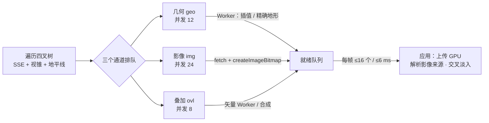

# 瓦片加载规范（底图 / 地形 / 3D Tiles）

代码：`src/globe/Globe.ts`（调度）、`src/globe/GlobeTile.ts`（瓦片与通道状态）、`src/globe/TileMaterial.ts`（交叉淡入）、`src/globe/tileMesh.worker.ts` + `src/globe/terrain/terrainTiling.ts`（地形取数与插值）、`src/tiles3d/`（3D Tiles）。测试：`tests/terrain.test.ts`。

目标是让用户看着的地方最先变清晰，全程不出现空洞、台阶或闪烁，帧时间保持平稳。

## 1. 管线总览

## 2. 可渲染条件与细化

- 瓦片有网格（`mesh !== null`）就可以渲染。影像按优先顺序解析：自身影像 → 最近的有影像的祖先（放大显示）→ 占位纹理。
- 一个瓦片只有在所有可见子瓦片都可渲染时才细化，否则先画自己，同时以 `B_REFINE` 优先级请求子瓦片的几何。
- 新影像替换旧来源（祖先放大图或占位图）时，用 `fadeDuration`（默认 0.3 s）交叉淡入。着色器始终采样 `fadeMap` 与 `imageryMap` 两张纹理（不淡入时二者相同，开销可以忽略）。

## 3. 优先级

| 桶 | 常量 | 内容 |
| --- | --- | --- |
| 0 | `B_REFINE` | 阻塞细化的子瓦片几何 |
| 1 | `B_ANCHOR` | 锚点影像：中间层级的祖先，一次请求就能让大片区域变清晰；按层级从粗到细 |
| 2 | `B_URGENT` | 显示的影像比自身粗 3 级以上的渲染瓦片；地形源切换后的几何 |
| 3 | `B_RENDERED` | 渲染瓦片的影像、叠加层、精确地形（替换临时网格）；中间层临时网格的精确地形 |
| 4 | `B_LOW` | 祖先的影像（作为兜底），最多占用三分之一的并发槽 |

同一个桶内按"离视野中心的角度 / 半对角视场角"排序（中心优先），其次按距离。锚点规则：渲染瓦片当前显示的影像来源层级为 a、目标层级为 L，当 `L − a > 3` 时，额外请求它在 `a + 3` 层的祖先（没有任何影像时请求根层）。这样一次大跨度缩放（例如从 L5 到 L17），屏幕会在一个往返内依次变清晰，而不是逐级等待。

在途加载如果连续 20 帧（`STALE_FRAMES`）不再被需要，就会被取消；失败按指数退避重试（1 s × 2^n，最长 30 s）。

## 4. 地形

### 4.1 取数层级偏移

`terrainLevelOffset(tileSize, segments) = log2(tileSize / segments)`。256 px 的 Terrarium / Terrain-RGB 对 32 格网格是 3：L 级网格从 L−3 级地形图里取一块 32×32 像素的子区域，每个网格单元正好对应一个像素，精度不变，请求量降到 1/64。MapTiler 的瓦片是 512 px（`tileSize: 512`），偏移为 4。quantized-mesh 维持原有的地理瓦片映射。

Worker 亲和路由（`terrainAffinity`）把读取同一张地形图的瓦片发到同一个 Worker，以命中其中的解码缓存。

### 4.2 临时（插值）网格规则

1. 子瓦片可以从最近的精确祖先的高度网格双线性插值，立即得到可渲染网格（Worker 同时预取精确地形），结果标记为 `upsampled`。
2. 只能从精确祖先插值，不能从另一个临时网格插值，且最多跨 3 级（`MAX_UPSAMPLE_LEVELS`）。超出范围就等待真实数据。
3. 临时瓦片的子瓦片，包围体使用精确祖先的高度范围（没有精确祖先时用全局范围 −120 m 至 8900 m × 夸张系数）。临时高度可能偏差数百米，用它裁剪会误剔子瓦片，造成空洞。
4. 遍历时遇到带临时网格的中间层瓦片，也会以 `B_RENDERED` 请求它的精确地形，避免错误高度长期残留。
5. 根瓦片在没有任何数据时先用平面网格立即显示（从轨道上看不出起伏），这样首屏不必等第一张地形图。它的 `dataLevel = -1`，不会被当作可靠地形。

违反第 2、3 条正是之前出现"高台 + 空洞 + 拉长裙边"的原因：L11 先是临时网格，L12 从它插值；L11 拿到真实地形后，L12 及以下仍残留约 500 m 的错误高度，子瓦片因此被视锥剔除。

### 4.3 `dataLevel` 与防入地

每块瓦片都记录构建网格时所用数据的层级（`dataLevel`）。`Globe.getHeight(lon, lat, maxCellSize)` 在数据网格间距大于 `maxCellSize` 时返回 null。

- 相机防入地使用 `GeoViewer.collisionGround`，要求 `maxCellSize = max(50 m, 离地高度 × 1.5)`，粗糙的估计不会把相机顶高。
- 建筑贴地使用 150 m 的门槛；在拿到可靠高度之前每 5 帧检查一次，之后每 30 帧检查一次。

## 5. 上传预算与背压

- 加载完成后进入 `ready` 队列，每帧在遍历之前应用，最多 16 个或 6 ms（`APPLY_BUDGET` / `APPLY_BUDGET_MS`）。
- 应用之前，加载一直占着通道的并发槽（`loading` 不清空），形成自然背压，也避免重复请求。
- 瓦片被卸载时 `epoch` 加一，属于旧内容的迟到结果会被丢弃，并释放对应的位图。

## 6. 缓存与淘汰

`maxCachedTiles` 默认 700。每 30 帧按"最久未访问、层级深的优先"淘汰；仍有子孙内容的瓦片不淘汰（叶子先走）。浏览器 HTTP 缓存里的压缩瓦片仍然有效，再次访问只需要解码和上传。

## 7. 3D Tiles

- `NodeMaterialPlugin.processTileModel`：把材质转为节点材质（`renderer.library.fromMaterial`），并设为双面。必须在这个钩子里做，原因见 AGENTS.md §3.5。
- LOD 渐显：`TilesFadePlugin`（300 ms，根瓦片也淡入）的 `_fadeMaterialManager` 换成 `NodeFadeMaterialManager`。渐变中的材质挂上共享的 `fadeMaskNode()`（4×4 Bayer dither，逻辑与官方 GLSL 版一致），结束后移除，恢复 early-Z。
- `UnloadTilesPlugin({ delay: 3000, bytesTarget: 192 MB })`：隐藏的瓦片在预算内保留在显存，转身回看时不需要重新上传。
- 进入建筑时，3D Tiles 会被临时压制（`suppressed`，既不绘制也不更新），避免遮挡室内。
- `errorTarget` 默认 12（Google 真实感 3D Tiles 用 20）。

## 8. 调参表

| 参数 | 默认 | 位置 | 调整建议 |
| --- | --- | --- | --- |
| `maxScreenSpaceError` | 1.25 px | GlobeOptions / 面板 | 调大会更快、更省，但更糊 |
| `maxConcurrentLoads` | 24 | 影像并发 | HTTP/1.1 的服务（单域名）可降到 8–12 |
| `maxConcurrentGeometry` | 12 | 几何并发 | 地形服务慢时不要调大，避免占满 Worker |
| `fadeDuration` | 0.3 s | 交叉淡入 | 0 表示直接切换 |
| `maxCachedTiles` | 700 | 缓存 | 集成显卡可降到 450 |
| `ANCHOR_GAP` | 3 | Globe.ts | 越小锚点越多：更早看到中间层级，但请求更多 |
| `MAX_UPSAMPLE_LEVELS` | 3 | Globe.ts | 不建议调大（山区台阶明显） |
| `APPLY_BUDGET` / `_MS` | 16 / 6 ms | Globe.ts | 帧时间敏感的场景可以调小 |
| `STALE_FRAMES` | 20 | Globe.ts | |

## 9. 观测与调试

- 状态栏会显示渲染瓦片数、缓存数、最大层级，以及"待影像"数（仍在用替代影像的渲染瓦片）。
- 控制台：`viewer.globe.stats`，`viewer.globe.renderList`，`viewer.globe.active.{geo,img,ovl}.size`。
- 排查空洞：取空洞处的经纬度，从根瓦片沿四叉树往下走，打印每一级的 `mesh` / `upsampled` / `dataLevel` / `minHeight..maxHeight` / 是否在渲染列表。重点看临时网格的高度是否离谱。
- 逐帧记录（不依赖帧率）：订阅 `viewer.events.on('frame', ...)` 记录 stats。自动化浏览器里 rAF 可能只有 1 帧/秒，按时间计算的结论不可信。

## 10. 改动守则

- 新的内容类型要作为一个通道或复用现有通道接入，不要绕开优先级和预算。
- 任何"临时 / 估计"数据都必须带上可信度标记（例如 `upsampled`、`dataLevel`），下游（裁剪、碰撞、贴地）要据此决定是否采用。
- 改调度逻辑后，至少手测三个场景：全球首屏；从全球飞到城市街道（`flyTo`，高度 300 m 以下）；山区倾斜视角（例如珠峰书签）。全程不能有空洞，相机不能被顶高。
