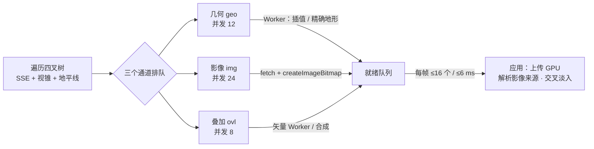

# 瓦片加载规范（底图 / 地形 / 3D Tiles）

代码：`src/globe/Globe.ts`（调度）、`src/globe/GlobeTile.ts`（瓦片与通道状态）、`src/globe/tileSelection.ts`（选择规则的纯函数）、`src/globe/TileMaterial.ts`（交叉淡入、地形渐变）、`src/globe/imagery/RequestScheduler.ts`（按域名限流）、`src/globe/tileMesh.worker.ts` + `src/globe/terrain/terrainTiling.ts`（地形取数与插值）、`src/tiles3d/`（3D Tiles）。测试：`tests/terrain.test.ts`、`tests/tileSelection.test.ts`、`tests/tileMeshLayout.test.ts`、`tests/requestScheduler.test.ts`。

目标是让用户看着的地方最先变清晰，全程不出现空洞、台阶或闪烁，帧时间保持平稳。

## 1. 管线总览

## 2. 可渲染条件与细化

- 瓦片有网格（`mesh !== null`）就可以渲染。影像按优先顺序解析：自身影像 → 最近的有影像的祖先（放大显示）→ 占位纹理。
- 一个瓦片只有在所有可见子瓦片都可渲染时才细化，否则先画自己，同时以 `B_BLOCKING` 优先级请求子瓦片的几何。
- **视野外的兄弟瓦片预建网格**（`preloadSiblings`，默认开）：瓦片细化时，不在视野内、但能直接插值出网格（不需要下载）的子瓦片，以 `B_LOW` 预先构网，而且不预取精确地形。否则平移或缩小时，子瓦片一进入视野就因为没有网格，迫使父瓦片退回显示、下一帧再细化，同一块区域来回切换。
- **象限填充**（Cesium 的 fill tile）：上一帧已经细化的瓦片，如果这一帧有子瓦片刚进入视野、还没有网格，就照常画已就绪的子瓦片，缺的那块用父瓦片网格对应的象限顶替（`GlobeTile.fills`），不再整体退回父瓦片。
  - 象限网格共享父网格的顶点缓冲，只多一份索引（`tileMeshLayout.ts` 的 `quadrantQuads`），用父瓦片的材质，所以画面就是父瓦片在那一块的样子。
  - 填充只能和父网格一起释放（替换几何或卸载时）。three 的 geometry dispose 会销毁它的所有属性缓冲，单独释放填充会连带毁掉父网格的顶点缓冲。
  - 拾取（`Globe.raycast`）同时检测渲染列表和填充网格。所有可见子瓦片都没有网格时，仍然画父瓦片。
- **本地构网的独立并发额度**：插值或平面网格不需要下载，在 Worker 里约 1 ms 就能建好。它们走独立的并发池（`LOCAL_GEOMETRY_LIMIT` = 32），不和下载精确地形的任务（`maxConcurrentGeometry`）抢槽位。否则阻塞细化的子瓦片要排在慢速下载后面，快速放大时细化会卡住好几秒。
- **选择记忆**：每块瓦片记录上一次遍历的结果（`TileSelection`：NONE / CULLED / RENDERED / REFINED，与 Cesium 的 `TileSelectionResult` 对应），后续判断依据"上一帧屏幕上是什么"。
- **不丢细节守卫**（Cesium `canRenderWithoutLosingDetail`）：一块瓦片满足 SSE、但上一帧处于 REFINED 状态（即它的子孙在屏幕上）时，只有在不会让细节消失的前提下才替换子孙：
  - 自身影像已就绪（或失败、或超出影像源层级范围）；否则，上一帧画出的子孙所显示的影像都不能比它当前能显示的更清晰。
  - 自身地形是精确地形（或失败）；否则，上一帧画出的子孙里不能有精确地形。
  - 不满足时继续画上一帧的子孙（`keptForDetail`，不再细化，也不为它们发起任何加载），同时以 `B_BLOCKING` 加载这块瓦片缺的影像或地形。这样缩小时不会先闪一下模糊的祖先影像再变清晰。
  - 判断规则是 `tileSelection.ts` 的 `wouldLoseDetail`，已有单测。
- **淡入的起点**：
  - 新影像替换旧来源（祖先放大图或占位图）时，用 `fadeDuration`（默认 0.5 s）交叉淡入。
  - **两张纹理必须是两个绑定**：three 会把哈希相同的 uniform 节点合并成一个绑定，纹理节点的哈希是**编译着色器时**所持纹理的 uuid（`TextureNode.getUniformHash`）。瓦片材质创建时 `imageryMap === fadeMap`，共享的瓦片着色器因此只有一个纹理槽：淡入期间两次采样读的是同一张（旧）纹理，"新影像"那一路用自身的 UV 采样祖先纹理，画面上出现整块祖先缩小后的错位副本（重影），淡入结束才跳成清晰影像。这是长期以来"加载闪烁"的根因。`TileMaterial.textureReference` 给每个纹理属性固定的独立哈希。验证方法：把所有渲染瓦片的 `fadeMap` 设为占位纹理，`fade = 1` 时画面不应出现深蓝色块，`fade = 0` 时应全部变深蓝。着色器始终采样 `fadeMap` 与 `imageryMap` 两张纹理（不淡入时二者相同，开销可以忽略）。
  - 只有上一帧就在屏幕上的瓦片才从旧画面淡入。新上屏的瓦片直接显示当前最好的影像；如果它替换的是父瓦片、且影像比父瓦片清晰（例如缓存里已有自身影像），就从父瓦片的画面（取对应象限，`childUvTransform`）淡入。
  - 以前的判定在渲染循环里先置了 `visible` 和 `lastRenderedFrame` 再判断"是否在屏幕上"，结果对新上屏的瓦片永远成立。瓦片就会从它很久以前显示过的粗影像（甚至占位色）开始淡入，缩小时尤其明显，是"缩放闪烁"的主要来源。
  - "上一帧这里画的是什么"由 `shownAncestor` 判断：上一帧画了自己的祖先（可能隔几级，快速放大时一帧细化多级），或者上一帧由父瓦片的象限填充顶替（`GlobeTile.filledFrame`）。后一种以前不淡入，子瓦片就绪时会直接跳到更清晰的影像。
  - **淡入中途换目标**：淡入进行到不足一半时又有新影像到达（例如锚点影像和自身影像先后到达），继续从原来的画面淡向新影像，不从中间画面重新开始；否则仍占主导的旧画面会一下子消失。
- **平稳揭示（先模糊、再成组变清晰）**：屏幕上的瓦片不在影像到达的那一帧立即切换，规则见 `tileSelection.ts` 的 `imagerySwitchDue`（有单测），由 `Globe.updateShownImagery` 执行：
  - 从占位色切换：立即。
  - 换成更清晰的祖先影像（锚点、预取的祖先）：等 `IMAGERY_COALESCE_MS`（400 ms），期间到达的更清晰影像合并成一次切换，不再逐级各淡入一次（以前 L5→L6→L8→L9 可能连闪三四次）。
  - 换成自身影像：等同一父瓦片下、这一帧画出的兄弟瓦片都拿到自身影像（或确定没有：超出层级、404、失败）后一起淡入，最多等 `IMAGERY_GROUP_WAIT_MS`（1.5 s）。这样变化单位是父瓦片大小的一块，而不是棋盘格式地一格格闪。
  - 为了让兄弟瓦片同时到达，渲染瓦片的影像请求按父瓦片排序（父瓦片离视野中心的角度和距离，组内再按自身），仍是屏幕中心优先，只是以"块"为单位。
  - 不在屏幕上的瓦片拿到影像后直接使用；新上屏的瓦片用当前最好的影像（必要时从祖先画面淡入）。
  - 状态栏"待显示"（`stats.heldImagery`）是已下载、正在等兄弟或合并的瓦片数。
  - 对照 CesiumJS：Cesium 不淡入，影像就绪即硬切换；它的平稳感来自"子瓦片都可渲染才替换父瓦片"、"子瓦片全是父数据插值就不细化"。我们的子瓦片一开始显示父影像的放大（画面不变），所以细化本身看不出来，可见变化只剩影像到达，于是把"成组"放在影像揭示上。
  - 实测（ArcGIS，从 L6 飞到 L12）：87% 的瓦片只变化一次；多数变化时刻是整组兄弟一起变。
- **地形渐变（morph）**：网格的高度变化在 `morphDuration`（默认 0.4 s）内完成，而不是一帧跳变。每个顶点带一个 `morphDelta` 属性（新高度 − 旧画面高度，米），着色器沿椭球法线把顶点画在 `高度 − (1 − morph) × morphDelta`，`morph` 是每瓦片的材质属性（`materialReference`）。三种情况：
  - 屏幕上的瓦片换网格（临时→精确、换地形源或夸张系数）：旧画面高度取旧网格（含正在进行的渐变）。实测 Cesium World Terrain 下，L10–L11 的临时网格（L8 数据插值）和精确网格在山区相差数百米，最大超过 1 km，倾斜视角下就是"地形跳一下"、画面错动。
  - 新上屏、替换祖先（放大）：旧画面取祖先网格的双线性采样。子瓦片的临时网格和祖先同源时差值为零，不做渐变。
  - 新上屏、替换子孙（缩小）：旧画面取上一帧画出的子孙（或象限填充）的高度。
  - 最大差值不到 0.5 m 时直接切换。拾取、贴地和防入地用的是最终高度，渐变期间可能有零点几秒的偏差。法线不渐变（开光照时明暗会直接切换）。
  - `morphDelta` 每个几何一份（约 5 KB / 瓦片），不能在瓦片间共享：three 释放几何时会销毁它用过的所有属性缓冲。象限填充共享父网格的这份属性。极地盖子也带一份全零的，与瓦片共用同一条管线。

## 3. 优先级

| 桶 | 常量 | 内容 |
| --- | --- | --- |
| 0 | `B_BLOCKING` | 阻塞层级切换的内容：阻塞细化的子瓦片几何；缩小时，满足 SSE 却因"不丢细节守卫"暂不能替换子孙的瓦片所缺的影像和精确地形 |
| 1 | `B_ANCHOR` | 锚点影像：中间层级的祖先，一次请求就能让大片区域变清晰；按层级从粗到细 |
| 2 | `B_URGENT` | 显示的影像比自身粗 3 级以上的渲染瓦片；地形源切换后的几何 |
| 3 | `B_RENDERED` | 渲染瓦片的影像、叠加层、精确地形（替换临时网格）；中间层临时网格的精确地形 |
| 4 | `B_LOW` | 祖先的影像（作为兜底）；视野外兄弟瓦片的插值网格。最多占用三分之一的并发槽 |

同一个桶内按"离视野中心的角度 / 半对角视场角"排序（中心优先），其次按距离。锚点规则：渲染瓦片当前显示的影像来源层级为 a、目标层级为 L，当 `L − a > 3` 时，额外请求它在 `a + 3` 层的祖先（没有任何影像时请求根层）。这样一次大跨度缩放（例如从 L5 到 L17），屏幕会在一个往返内依次变清晰，而不是逐级等待。

在途加载如果连续 20 帧（`STALE_FRAMES`）不再被需要，就会被取消；失败按指数退避重试（1 s × 2^n，最长 30 s）。

### 3.1 按域名限流（HTTP/1.1 影像服务）

- 浏览器对 HTTP/1.1 服务每个域名只开约 6 个连接。影像通道默认并发 24，多出来的约 18 个请求排在浏览器网络栈里，先来先服务：我们的优先级（视野中心优先、阻塞内容优先）在那里不起作用，已经移出视野的请求还挡在新请求前面。
- `server.arcgisonline.com`（ArcGIS 影像、地形图、边界地名、交通叠加）只支持 HTTP/1.1，从国内访问单张约 300–800 ms，握手约 600 ms。之前用它时屏幕上 80 多块瓦片要等十几秒才全部变清晰。
- 做法：
  - 预设声明 `maxRequestsPerHost`（ArcGIS 为 6），`XYZImageryProvider.requestBlob` 经 `scheduleRequest` 按域名限并发，超出的在我们这边排队，取消时立即出队。底图和叠加层同域名时共用这 6 个名额。
  - Provider 据此报告 `maxConcurrentRequests`（每域名额度 × 子域名数），Globe 的影像通道最多同时派发这么多。排队留在每帧重排的优先级队列里，不再进浏览器的 FIFO。
  - 已经开始的下载不中止：中止 HTTP/1.1 响应会关闭连接，下一个请求要重新握手，代价常常比把剩下的字节下完还大。这类"取消后才到达"的影像照常应用和缓存（`applyReady` 对影像通道不因取消而丢弃，换了影像源的结果仍由代数检查丢弃）。
- HTTP/2 服务（OSM、Carto 等）不设 `maxRequestsPerHost`，行为不变：仍由通道并发限流，取消即中止。
- 跨域请求没有 `Timing-Allow-Origin` 时 `nextHopProtocol` 为空，无法自动探测协议，新增 HTTP/1.1 的源要在预设里手动声明。可以用 Node 的 `tls.connect({ ALPNProtocols: ['h2', 'http/1.1'] })` 查看服务端协商结果。

### 3.2 预取下一级影像（只进 HTTP 缓存）

放大时屏幕中心的瓦片要等一个网络往返（ArcGIS 从国内 300–800 ms，排队时更久）才变清晰。`Globe.prefetchNextLevel` 在空闲时把下一级影像提前下载进浏览器 HTTP 缓存，放大后的请求直接命中缓存。

- **只下载、不解码、不上传**：`ImageryProvider.prefetch` 读完响应体就丢弃，不占主线程、内存和显存，也不进瓦片缓存（不会挤掉 700 块里有用的瓦片）。真正需要时走正常的 `requestImage`，请求的 `mode` / `credentials` 与预取相同，才能命中同一条缓存。依赖服务端的缓存头（ArcGIS 为 `max-age=86400`）；`no-store` 的服务预取无效，应关闭。
- **只取下一级、只取视野中心**：渲染瓦片满足 `shouldPrefetchChildren`（SSE ≥ 阈值的一半，即大约再放大一步就要细化；离视野中心不超过半对角视场角的 0.4 倍）时，预取它的四个子瓦片，按离中心远近排序。每个瓦片对同一影像源只取一次。
- **只用空闲容量**：只要还有屏幕上（或阻塞层级切换）的瓦片在排队等影像，就不发起预取；作为兜底的祖先影像（`B_LOW`）不算。最多同时 `PREFETCH_MAX_ACTIVE`（2）个，影像通道的派发上限相应减去在途预取数，HTTP/1.1 的源上可见瓦片至少还有 4 个连接。
- **可关闭**：`GlobeOptions.prefetchImagery`（默认开）；影像源用 `XYZImageryOptions.prefetch: false` 关闭（天地图预设已关闭：key 有日访问量限制）。换影像源时清空记录，未开始的预取立即取消。
- 不用 `fetch` 的 `priority: 'low'`：Chrome 会把低优先级请求压在其他请求之后，单张要 1–2 s；优先级已经由我们自己的调度保证。
- 实测（ArcGIS 地形图，80 km 高度空闲后放大到 40 km）：屏幕中心 14 块瓦片全部显示最终影像，用时从 4.7 s 降到 0.72 s（基本只剩相机动画和淡入）。
- 代价：流量（中心约 20 块 × 4 个子瓦片，每张约 20 KB，每层约 1–2 MB），用户不放大时这部分浪费；服务端请求量增加。叠加层（注记等）暂不预取。
- `stats.prefetching` 是在途预取数。

取消要真正释放资源：
- 几何任务被取消时，`TileWorkerPool` 立即结束这个 Promise、归还并发槽，不等 Worker 回复（Worker 的迟到回复直接丢弃）。
- Worker 里同一张地形图的下载由需要它的任务共享（`sharedLoad` / `waitFor`）。最后一个等待它的任务被取消时，用 `AbortController` 中止这次下载；预取不计入等待者。
- 以前取消只是打个标记，槽位和 HTTP 连接要等网络返回才释放。地形服务大多是 HTTP/1.1（每个域名约 6 个连接），快速缩放时过期请求占满连接，细化会卡住好几秒。

## 4. 地形

### 4.1 取数层级偏移

`terrainLevelOffset(tileSize, segments) = log2(tileSize / segments)`。256 px 的 Terrarium / Terrain-RGB 对 32 格网格是 3：L 级网格从 L−3 级地形图里取一块 32×32 像素的子区域，每个网格单元正好对应一个像素，精度不变，请求量降到 1/64。MapTiler 的瓦片是 512 px（`tileSize: 512`），偏移为 4。quantized-mesh 维持原有的地理瓦片映射。

Worker 亲和路由（`terrainAffinity`）把读取同一张地形图的瓦片发到同一个 Worker，以命中其中的解码缓存。

### 4.2 临时（插值）网格规则

1. 子瓦片可以从最近的精确祖先的高度网格双线性插值，立即得到可渲染网格（Worker 同时预取精确地形），结果标记为 `upsampled`。
2. 只能从精确祖先插值，不能从另一个临时网格插值，且最多跨 3 级（`MAX_UPSAMPLE_LEVELS`）。超出范围就等待真实数据。
3. 临时瓦片的子瓦片，包围体使用精确祖先的高度范围（没有精确祖先时用全局范围 −120 m 至 8900 m × 夸张系数）。临时高度可能偏差数百米，用它裁剪会误剔子瓦片，造成空洞。
4. 遍历时遇到带临时网格的中间层瓦片，也会以 `B_RENDERED` 请求它的精确地形，避免错误高度长期残留。
5. 根瓦片在没有任何数据时先用平面网格立即显示（从轨道上看不出起伏），这样首屏不必等第一张地形图。它的 `dataLevel = -1`，不会被当作可靠地形。

违反第 2、3 条正是之前出现"高台 + 空洞 + 拉长裙边"的原因：L11 先是临时网格，L12 从它插值；L11 拿到真实地形后，L12 及以下仍残留约 500 m 的错误高度，子瓦片因此被视锥剔除。

### 4.3 `dataLevel` 与防入地

每块瓦片都记录构建网格时所用数据的层级（`dataLevel`）。`Globe.getHeight(lon, lat, maxCellSize)` 在数据网格间距大于 `maxCellSize` 时返回 null。

- 相机防入地使用 `GeoViewer.collisionGround`，要求 `maxCellSize = max(50 m, 离地高度 × 1.5)`，粗糙的估计不会把相机顶高。
- 建筑贴地使用 150 m 的门槛；在拿到可靠高度之前每 5 帧检查一次，之后每 30 帧检查一次。

## 5. 上传预算与背压

- 加载完成后进入 `ready` 队列，每帧在遍历之前应用，最多 16 个或 6 ms（`APPLY_BUDGET` / `APPLY_BUDGET_MS`）。
- 应用之前，加载一直占着通道的并发槽（`loading` 不清空），形成自然背压，也避免重复请求。
- 瓦片被卸载时 `epoch` 加一，属于旧内容的迟到结果会被丢弃，并释放对应的位图。

## 6. 缓存与淘汰

`maxCachedTiles` 默认 700。每 30 帧按"最久未访问、层级深的优先"淘汰；仍有子孙内容的瓦片不淘汰（叶子先走）。浏览器 HTTP 缓存里的压缩瓦片仍然有效，再次访问只需要解码和上传。

## 7. 3D Tiles

- `NodeMaterialPlugin.processTileModel`：把材质转为节点材质（`renderer.library.fromMaterial`），并设为双面。必须在这个钩子里做，原因见 AGENTS.md §3.5。
- LOD 渐显：`TilesFadePlugin`（300 ms，根瓦片也淡入）的 `_fadeMaterialManager` 换成 `NodeFadeMaterialManager`。渐变中的材质挂上共享的 `fadeMaskNode()`（4×4 Bayer dither，逻辑与官方 GLSL 版一致），结束后移除，恢复 early-Z。
- `UnloadTilesPlugin({ delay: 3000, bytesTarget: 192 MB })`：隐藏的瓦片在预算内保留在显存，转身回看时不需要重新上传。
- 进入建筑时，3D Tiles 会被临时压制（`suppressed`，既不绘制也不更新），避免遮挡室内。
- `errorTarget` 默认 12（Google 真实感 3D Tiles 用 20）。

## 8. 调参表

| 参数 | 默认 | 位置 | 调整建议 |
| --- | --- | --- | --- |
| `maxScreenSpaceError` | 1.25 px | GlobeOptions / 面板 | 调大会更快、更省，但更糊 |
| `maxConcurrentLoads` | 24 | 影像并发 | HTTP/1.1 的服务（单域名）可降到 8–12 |
| `maxConcurrentGeometry` | 12 | 几何并发 | 地形服务慢时不要调大，避免占满 Worker |
| `fadeDuration` | 0.5 s | 交叉淡入 | 0 表示直接切换 |
| `prefetchImagery` / `PREFETCH_MAX_ACTIVE` | 开 / 2 | GlobeOptions / tileSelection.ts | 流量敏感（移动网络、按量计费的服务）时关闭；HTTP/2 的源可以适当调大 |
| `IMAGERY_COALESCE_MS` / `IMAGERY_GROUP_WAIT_MS` | 400 / 1500 ms | tileSelection.ts | 调大更平稳但清晰得更晚；影像源快时可以调小 |
| `morphDuration` | 0.4 s | 地形渐变 | 0 表示直接切换（山区层级切换时地形会跳） |
| `maxRequestsPerHost` | ArcGIS 6，其余不限 | `XYZImageryOptions` / 预设 | HTTP/1.1 的服务设为 6；HTTP/2 的不要设 |
| `maxCachedTiles` | 700 | 缓存 | 集成显卡可降到 450 |
| `fogScreenSpaceErrorFactor` | 1 | GlobeOptions | 地平线雾化：相机低、视线接近水平时，雾中的远处瓦片少细化，完全在雾中的瓦片要达到 2 倍阈值才细化（Cesium `Fog.screenSpaceErrorFactor` 的相对版）。0 关闭 |
| `preloadSiblings` | true | GlobeOptions | 视野外兄弟瓦片预建插值网格；关掉可以略省内存，但平移和缩小时可能来回切换 |
| `ANCHOR_GAP` | 3 | Globe.ts | 越小锚点越多：更早看到中间层级，但请求更多 |
| `MAX_UPSAMPLE_LEVELS` | 3 | Globe.ts | 不建议调大（山区台阶明显） |
| `LOCAL_GEOMETRY_LIMIT` | 32 | Globe.ts | 无需下载的构网任务的并发上限；Worker 少（2 核以下）时可降到 16 |
| `APPLY_BUDGET` / `_MS` | 16 / 6 ms | Globe.ts | 帧时间敏感的场景可以调小 |
| `STALE_FRAMES` | 20 | Globe.ts | |

## 9. 观测与调试

- 状态栏会显示渲染瓦片数、缓存数、最大层级，以及"待影像"数（仍在用替代影像的渲染瓦片）、"保留"数（`stats.keptForDetail`：缩小时为了不丢细节暂时保留的较细瓦片）。
- 控制台：`viewer.globe.stats`，`viewer.globe.renderList`，`viewer.globe.active.{geo,img,ovl}.size`。
- 排查空洞：取空洞处的经纬度，从根瓦片沿四叉树往下走，打印每一级的 `mesh` / `upsampled` / `dataLevel` / `minHeight..maxHeight` / 是否在渲染列表。重点看临时网格的高度是否离谱。
- 逐帧记录（不依赖帧率）：订阅 `viewer.events.on('frame', ...)` 记录 stats。自动化浏览器里 rAF 可能只有 1 帧/秒，按时间计算的结论不可信。

## 10. 与 CesiumJS 的对照

参考 `QuadtreePrimitive.js`、`GlobeSurfaceTileProvider.js`、`TileImagery.js`、`TileReplacementQueue.js`、`Fog.js`（CesiumJS main 分支，Apache-2.0，只读源码、按思路重写）。

| CesiumJS 做法 | 本项目 | 说明 |
| --- | --- | --- |
| `TileSelectionResult` 记录上一帧的选择结果 | 已采用：`TileSelection` | 决策依据"上一帧屏幕上是什么"，避免无记忆的来回切换 |
| `canRenderWithoutLosingDetail`：缩小时，父瓦片的影像和地形就绪才替换子孙，否则保留子孙并以 High 优先级加载父瓦片 | 已采用：`losesDetail` + `B_BLOCKING` | 我们比较的是实际显示的影像层级，比 Cesium 只看"是否加载完"更精确 |
| 子瓦片没有地形时用 fill mesh（由邻接边缘拼出）补洞 | 改用父瓦片的象限网格 | 我们的父子网格同布局，取索引子集就够，不需要拼边 |
| `preloadSiblings`（默认关） | 默认开，但只预建无需下载的插值网格 | 代价低，消除平移和缩小时的切换 |
| `preloadAncestors`、High / Medium / Low 三级队列、按 `(1 - cos) × 距离` 排序 | 早已有：5 个优先级桶 + 视野中心优先 | 桶更细：锚点影像、粗影像优先 |
| `loadingDescendantLimit`：待加载的子孙过多时先加载祖先 | 用锚点影像（`B_ANCHOR`）替代 | 我们的几何靠插值立即可得，瓶颈在影像 |
| 雾化 SSE：`sse -= fog(距离) × 2` | 已采用：`fogScreenSpaceErrorFactor`，按阈值的倍数计 | 只在相机低、视线接近水平时生效 |
| `RequestScheduler`：按服务器限制并发，排不上的请求下一帧重排 | 已采用：预设声明的 HTTP/1.1 服务按域名限流（§3.1），通道并发不超过服务能接的数量 | 地形 Worker 的下载尚未接入 |
| 地形层级切换直接替换网格 | 有地形渐变（§2） | 临时网格误差可达数百米，直接替换在倾斜视角下很明显 |
| 影像替换直接切换，没有淡入；子瓦片都可渲染才替换父瓦片 | 交叉淡入 + 合并中间层级 + 兄弟成组揭示 | 修正了"从过期画面淡入"的问题（§2） |
| `TileReplacementQueue`：LRU，本帧用到的不卸载 | 早已有：按最近访问和层级淘汰，叶子先走 | — |

## 11. 改动守则

- 新的内容类型要作为一个通道或复用现有通道接入，不要绕开优先级和预算。
- 任何"临时 / 估计"数据都必须带上可信度标记（例如 `upsampled`、`dataLevel`），下游（裁剪、碰撞、贴地）要据此决定是否采用。
- 改调度逻辑后，至少手测三个场景：全球首屏；从全球飞到城市街道（`flyTo`，高度 300 m 以下）；山区倾斜视角（例如珠峰书签）。全程不能有空洞，相机不能被顶高。
